# PSX Intelligence AI — Agent Interaction Diagram (Phase 1)

**Phase:** 1 of 30 — specification / diagrams only. No application code, no
agent implementation, no Phase 2 work.

**Canonical diagram file:** [`AGENT_INTERACTION_DIAGRAM.mmd`](AGENT_INTERACTION_DIAGRAM.mmd)
— the `.mmd` file is canonical. The Mermaid code embedded in §2 below is the
**same content, verbatim**, as that file. If the two ever differ, the `.mmd`
file governs and this document must be corrected.

**Scope limit (explicit).** This document covers **interaction, sequencing,
and message flow only**: orchestrator → agents → deterministic calculation
functions → storage/audit, human-in-the-loop gates, and the independent audit
agent's veto/audit path. It does **NOT duplicate the agent registry itself**
— the registry (agent identities, roles, capabilities, prompts) belongs to
another team. Where this document names an agent, it names a *role* to be
looked up in that registry; if the role is missing, the task fails loudly
rather than substituting an unregistered agent.

**Budget:** PKR 0 absolute zero-cost. No paid AI subscription is used: AI
assistance in this design is **Ollama local inference only** (see deployment
doc). Local hardware, electricity, and internet are external operating
expenses — disclosed, never called free.

**Workflow position (11 stages):** Stages 5–7 (architecture planning,
implementation specification, documentation). Agent *implementation* and agent
*testing* belong to later phases; the testing strategy is defined here and in
the deployment doc, not claimed passed.

**Hard rules:** Financial numbers come **only** from deterministic calculation
functions. Agents (including any LLM-assisted agent) may select a function,
explain a stored result, or draft text citing a stored result — they may
**never invent, adjust, or override a number**. The audit agent's veto cannot
be overridden by the recommending agent. **No real trades** are executed at
any point in this flow, initially or otherwise in Phase 1 design — decision
outputs are candidates and proposed allocations for review only, with no
broker connection.

---

## 1. Roles in this diagram (roles only — registry owned elsewhere)

| Role | Layer | Does | Never does |
|---|---|---|---|
| Orchestrator (Layer 7) | 7 | Assigns tasks in dependency order, tracks state, bounded retries for transient failures, monitoring, cost control | Computes financial numbers; overrides validation or audit |
| Collection agent | 1 | Runs a collection task within source limits; emits raw + provenance | Validates content; bypasses rate limits |
| Validation agent | 2 | Runs the five Layer 2 checks; emits validated/flagged/conflict records | Merges conflicts silently; corrects source values |
| Analysis agent | 4 | Calls deterministic analysis functions with stored input ids | Invents an indicator/ratio value |
| Forecasting agent | 5 | Calls deterministic forecast functions; assembles scenarios + validation | Generates forecast numbers via LLM text |
| Decision agent | 6 | Calls deterministic risk/optimisation functions; produces candidates + proposed allocations | Publishes a recommendation; executes a trade |
| Independent audit agent | 6 (separate path) | Checks candidates against inputs, versions, validation status, conflicts, audit rules; passes / flags / vetoes | Shares the recommendation engine's config as its only check; lets a veto be bypassed by the decision agent |
| Human gate reviewer | Gate | Approves/rejects gated recommendations; decision recorded in task state + audit log | Approves informally (e.g. chat message) without a recorded task outcome |

**Deterministic calculation functions** are not agents. They are versioned
Python functions (in the fixed stack: Python / FastAPI / Pydantic API design)
that take stored input record ids and return numbers. They have no LLM, no
discretion, and no access to external sources. Every number they return is
recorded with `function_version` + `input_record_ids`.

## 2. Canonical agent-interaction diagram (verbatim from AGENT_INTERACTION_DIAGRAM.mmd)

```mermaid
flowchart TB
    subgraph L7["LAYER 7 - Orchestrator (control plane, computes NO financial numbers)"]
        ORCH["Orchestrator<br/>task manager, scheduler, bounded retries,<br/>monitoring, cost control (PKR 0 budget)"]
        REG["Agent registry (OTHER TEAM OWNS)<br/>looked up, never redefined here"]
    end
    subgraph AGENTS["Agents (roles via registry)"]
        COL["Collection agent<br/>Layer 1"]
        VALA["Validation agent<br/>Layer 2"]
        ANA["Analysis agent<br/>Layer 4"]
        FCA["Forecasting agent<br/>Layer 5"]
        DECA["Decision agent<br/>Layer 6: risk, candidates, optimisation"]
        AUDITA["Independent audit agent<br/>Layer 6: separate path, VETO power"]
    end
    subgraph DET["Deterministic calculation functions<br/>Python - the ONLY source of financial numbers"]
        FN_AN["Analysis functions<br/>versioned"]
        FN_FC["Forecast functions<br/>versioned"]
        FN_RISK["Risk / optimisation functions<br/>versioned"]
    end
    subgraph L3["LAYER 3 - Storage"]
        RAW["Raw store (immutable)"]
        VAL["Validated store"]
        DER["Derived store"]
        AUDLOG["Audit log (append-only)"]
    end
    HUMAN["Human-in-the-loop gate<br/>recommendation approval"]
    UI["Layer 8 UI<br/>audit-passed views only"]
    ORCH -->|"lookup role"| REG
    REG -->|"agent binding (or fail loudly if missing)"| ORCH
    ORCH -->|"task: collect (idempotency key)"| COL
    COL -->|"raw payload + provenance"| VALA
    VALA -->|"validated / flagged / conflict records"| VAL
    VALA -->|"intake-checked raw"| RAW
    VALA -->|"validation failure alert (permanent: no retry loop)"| ORCH
    ORCH -->|"task: analyse (only after validation)"| ANA
    ANA -->|"call with input_record_ids"| FN_AN
    FN_AN -->|"numbers + function_version"| ANA
    ANA -->|"analysis + input linkage"| DER
    ORCH -->|"task: forecast (only after analysis)"| FCA
    FCA -->|"call with input_record_ids"| FN_FC
    FN_FC -->|"numbers + function_version"| FCA
    FCA -->|"forecasts + validation"| DER
    ORCH -->|"task: decide (only after forecast)"| DECA
    DECA -->|"call with input_record_ids"| FN_RISK
    FN_RISK -->|"numbers + function_version"| DECA
    DECA -->|"recommendation CANDIDATE (not publishable yet)"| AUDITA
    DECA -->|"proposed allocation (not executed, NO real trades)"| AUDITA
    AUDITA -->|"read inputs, versions, conflicts, validation status"| DER
    AUDITA -->|"read validated records"| VAL
    AUDITA -->|"verdict: passed / flagged / vetoed + reasons"| AUDLOG
    AUDITA -->|"passed only"| DER
    AUDITA -.->|"VETO: candidate blocked, never reaches UI, alert to orchestrator"| ORCH
    AUDITA -->|"flagged: needs human gate"| HUMAN
    AUDITA -->|"passed + gate-required: needs human gate"| HUMAN
    HUMAN -->|"approve (recorded)"| ORCH
    HUMAN -->|"approve / reject (recorded)"| AUDLOG
    HUMAN -.->|"reject: output stays unpublished"| AUDLOG
    ORCH -->|"publish task (passed + gated only)"| UI
    DER -->|"audit-passed views only"| UI
    ORCH -.->|"bounded retry: transient failures ONLY (network, temp storage)"| COL
    ORCH -.->|"NO retry: validation failure, audit veto, missing registry role"| AUDITA
```

**Diagram conventions.** Solid arrows = task assignment, result, or verdict
flows. Dashed arrows = veto/alert and no-retry rules — i.e. the constraints
that prevent a blocked output from being retried or published around the
audit path. There is no arrow from any agent to a broker, a payment service,
or an external AI API — none exists in this design.

---

## 3. Walkthrough — every interaction, in sequence

### 3.1 Registry lookup (before any work)

1. **Orchestrator → Registry: lookup role.** For each task, the orchestrator
   looks up the required role in the other team's registry. It does not
   redefine the role, invent an agent, or hard-code an agent identity here.
2. **Registry → Orchestrator: agent binding (or fail loudly).** If the role
   exists, the binding is returned and the task proceeds. If it is missing,
   the task fails with "role not in registry" — it is not assigned to a
   lookalike agent, and it is not retried (see §5, no-retry rules).

### 3.2 Collection → validation

3. **Orchestrator → Collection agent: task "collect" (with idempotency key).**
   The task names what to collect, which source slot, and the schedule. The
   idempotency key means a retried task cannot duplicate a collection write
   or a send. In Phase 1, no full-scale collection task is actually run
   (read-only inspection only); this step describes the later-phase sequence.
4. **Collection agent → Validation agent: raw payload + provenance.** The
   handoff is agent-to-agent via the orchestrator's message flow in
   implementation terms, but logically it is raw + provenance into Layer 2.
   The collection agent performs no content validation.
5. **Validation agent → Validated store: validated / flagged / conflict
   records.** The five Layer 2 checks, in order (see data-flow doc).
6. **Validation agent → Raw store: intake-checked raw.** Raw lands immutable.
7. **Validation agent → Orchestrator: validation failure alert.** A validation
   failure is a **permanent** outcome for that task, not a transient error: it
   is alerted, not retried in a loop. The orchestrator may schedule a *new*
   task (e.g. after a registry/config fix) but must not silently retry the
   failed one until its cause is recorded as addressed.

### 3.3 Analysis (deterministic functions only)

8. **Orchestrator → Analysis agent: task "analyse" (only after validation).**
   Dependency order is enforced: analysis tasks for a dataset do not start
   until validation for that dataset is complete. Starting analysis on
   unvalidated data is a sequencing violation, not a shortcut.
9. **Analysis agent → Analysis functions: call with input_record_ids.** The
   agent supplies *which stored inputs* to compute over and *which function
   version* to use. It does not supply numbers, and it does not compute
   anything itself by LLM judgement.
10. **Analysis functions → Analysis agent: numbers + function_version.** The
    only numbers in this step. They are deterministic: same inputs + same
    function version = same output.
11. **Analysis agent → Derived store: analysis + input linkage.** Output is
    stored with its inputs, version, computation date (PKT), and limitations
    before any downstream agent reads it.

### 3.4 Forecasting (same discipline)

12. **Orchestrator → Forecasting agent: task "forecast" (only after
    analysis).** Forecasting reads stored analysis (via Layer 3) as its input,
    so it is reproducible.
13. **Forecasting agent → Forecast functions: call with input_record_ids.**
    Same contract as §3.3: the agent selects model/parameters from
    pre-defined options; the function produces the numbers.
14. **Forecast functions → Forecasting agent: numbers + function_version.**
15. **Forecasting agent → Derived store: forecasts + validation.** Scenarios,
    assumptions, uncertainty, and validation results travel with the numbers.
    AI-assisted drafting (Ollama local inference only) may summarise these
    stored results or draft explanations — it may not generate or alter the
    numbers, and any drafted text citing a number must cite the stored output
    it came from.

### 3.5 Decisions → independent audit (the critical path)

16. **Orchestrator → Decision agent: task "decide" (only after forecast).**
17. **Decision agent → Risk/optimisation functions: call with
    input_record_ids.** Risk measures and proposed allocations come from
    these functions only.
18. **Risk/optimisation functions → Decision agent: numbers +
    function_version.**
19. **Decision agent → Independent audit agent: recommendation CANDIDATE.**
    Labelled candidate deliberately: at this point it is **not publishable**,
    not shown to any user, and not a recommendation in the user-facing sense.
20. **Decision agent → Independent audit agent: proposed allocation (not
    executed).** A proposed allocation is a document for review. There is no
    step after this that places an order, and no broker connection to place
    one through. **The system must NOT execute real trades initially** — this
    is a design invariant, not a Phase 1 deferral note: the audit path has no
    execution branch.
21. **Audit agent → Derived store: read inputs, versions, conflicts,
    validation status.** The audit agent independently re-reads what the
    candidate claims to be based on; it does not take the decision agent's
    summary on trust.
22. **Audit agent → Validated store: read validated records.** Same
    independence: validation status and conflict records are checked from
    storage, not from the candidate's own claims.
23. **Audit agent → Audit log: verdict passed / flagged / vetoed + reasons.**
    Every candidate gets a verdict record, including vetoed ones. The log is
    append-only; a verdict is never edited — a re-review creates a new record.
24. **Audit agent → Derived store: passed only.** Only a `passed` verdict
    writes the candidate back as a publishable decision output. `flagged` and
    `vetoed` candidates are not written as publishable outputs.

### 3.6 Veto path (dashed — the path that blocks publication)

25. **Audit agent - - → Orchestrator: VETO alert.** A veto blocks the
    candidate, alerts the orchestrator, and never reaches the UI. The
    orchestrator does not retry a vetoed candidate, does not route it to a
    different agent to "get a better verdict", and does not publish a softened
    version of it. The only route back is a new, separately recorded review
    (new inputs, new function version, or a recorded human decision that
    re-opens it under the gate rules in §4) — never a silent retry.

### 3.7 Human-in-the-loop gates

26. **Audit agent → Human gate: flagged needs gate.** A flagged candidate
    goes to a human reviewer; it is not published while flagged.
27. **Audit agent → Human gate: passed + gate-required needs gate.** Some
    recommendation classes require a human gate even after passing audit
    (which classes is a configuration decision for Phase 2, recorded in the
    audit rules — not invented here). Passing audit alone does not publish a
    gate-required recommendation.
28. **Human gate → Orchestrator: approve (recorded).** The approval is a
    recorded task outcome, visible in task state.
29. **Human gate → Audit log: approve / reject (recorded).** The same decision
    is recorded as evidence, with reviewer identity (as defined by the admin
    system in Phase 2) and reason.
30. **Human gate - - → Audit log: reject keeps output unpublished.** A
    rejection is not a deletion: the candidate and its verdicts remain in the
    log, but no publish task is issued for it.

### 3.8 Publication (only after audit + gate)

31. **Orchestrator → UI: publish task (passed + gated only).** The publish
    task is issued only when both conditions hold: audit `passed`, and any
    required human gate approved. Either condition missing = no publish task.
32. **Derived store → UI: audit-passed views only.** The UI reads publishable
    outputs from storage; it never reads a candidate directly from the
    decision agent.

### 3.9 Retries — what retries and what never retries

| Outcome | Retry? | Why |
|---|---|---|
| Transient failure (network/library error, temporary storage unavailability) | Yes — bounded, with backoff, under an idempotency key | The task itself was sound; only its execution failed |
| Validation failure | No (alert, new task only after cause addressed) | Retrying the same inputs reproduces the same failure and hides the defect |
| Audit veto | No | A veto is a judgement on the candidate, not an execution error |
| Missing registry role | No | No agent exists to retry with; the registry must be fixed first |
| Human gate rejection | No (new review only, as a new recorded decision) | Rejection is a decision, not a failure |

**Cost control in this flow.** Every task records its cost drivers (calls,
compute time, storage) where measurable. Under the PKR 0 budget, cost control
means: no paid service is invoked at all, local compute is bounded (task
budgets stop or alert rather than running unbounded), and any future paid
service would need a separate budget approval before its task type is enabled
— it cannot be enabled by an agent at runtime.

## 4. Message flow — shape of each message (specification, not code)

Every orchestrator↔agent message carries, at minimum: `message_version`,
`task_id`, `idempotency_key`, `role`, `inputs` (stored record ids, never raw
financial claims), `expected_output` (store location + shape), and
`reply_to`. Every agent reply carries: `task_id`, `status`
(`done` / `failed` / `flagged`), `output_record_ids` (for stored outputs),
`function_version` (where a deterministic function was called), and
`failure_or_flag_reason` where applicable. Audit verdicts additionally carry
`verdict`, `checked_inputs`, and `audit_rule_version`. A message missing its
version or task id is not acted on in a production config (local-dev may log
a warning — see deployment doc).

**LLM boundary, restated for this diagram.** An LLM-assisted agent sits
*around* the deterministic functions, never *instead of* them: it can choose
which pre-defined function to call, summarise a stored result, and draft
explanatory text. It cannot produce a number that is not a stored function
output, cannot edit a function output in transit, and cannot issue or
override an audit verdict. Ollama local inference is the only AI route in
this design; no cloud AI API appears in any message flow.

## 5. Failure sequencing — what happens when a step fails

- **Collection fails transiently:** bounded retry (dashed arrow back to the
  collection agent, under the same idempotency key). Sustained failure →
  alert, missing entries recorded by validation for expected sessions.
- **Validation fails:** task flagged, alert to orchestrator, downstream tasks
  for that dataset do not start. No analysis/forecast/decision task is issued
  on unvalidated data to "keep the pipeline moving".
- **A deterministic function fails (e.g. insufficient validated inputs):**
  the calling agent reports `failed` with the reason (e.g.
  "insufficient-data"); the output is absent/flagged, not approximated.
- **Audit vetoes:** §3.6. The pipeline for that candidate ends; other
  candidates are unaffected.
- **Orchestrator unavailable:** tasks queue; on recovery they resume from
  recorded state, not from scratch where idempotency allows. No agent runs
  unsupervised while the orchestrator is down.

---

*Layer specs: `SYSTEM_ARCHITECTURE.md`. System diagram (canonical .mmd):
`SYSTEM_ARCHITECTURE.mmd` / `SYSTEM_ARCHITECTURE_DIAGRAM.md`. Data flows:
`DATA_FLOW_DIAGRAM.md` (+ `.mmd`). Deployment:
`DEPLOYMENT_ARCHITECTURE.md` (+ `.mmd`). Agent registry: owned by another
team — not duplicated here.*
