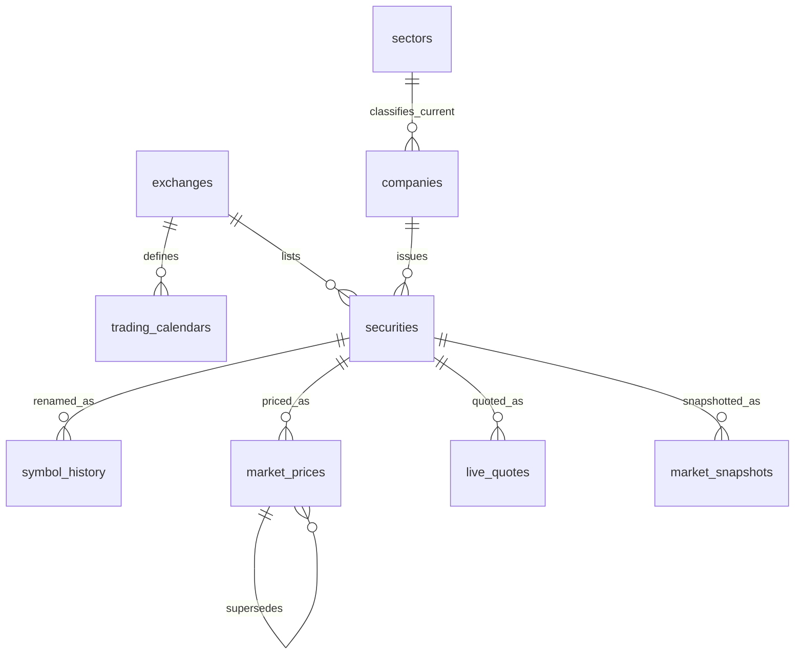
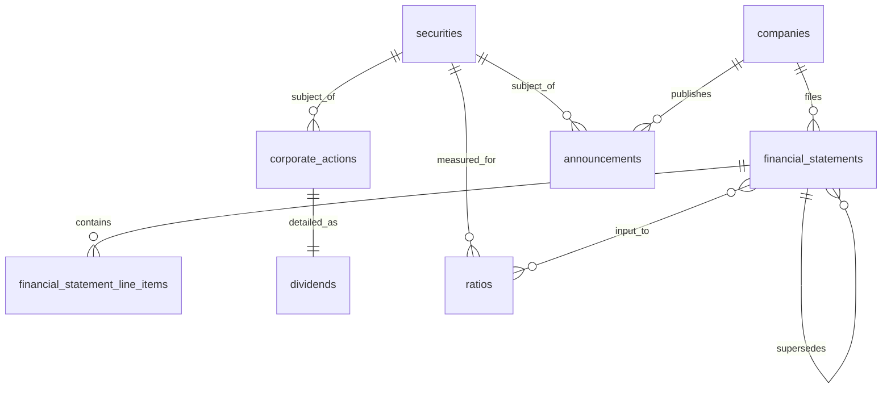
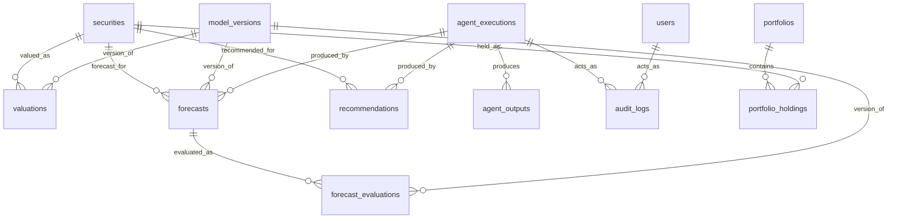

# PSX Intelligence AI — Database Relationships (Phase 1 of 30)

> **Status: DESIGN ONLY — Phase 1, Team 6. STOP AFTER PHASE 1.**
> No database has been created. Diagrams are Mermaid ER notation for a
> later SQLAlchemy/Alembic implementation; they are not a running schema.
> Entity definitions: `DATABASE_ENTITY_CATALOG.md`. Principles, budget
> (PKR 0; local filesystem + Parquet + optional self-hosted MinIO;
> hardware/electricity/internet are external operating expenses, never
> "free"), and provenance: `DATABASE_DESIGN.md`.
>
> **Conventions used below:**
> - Cardinality is written as `1 — N`, `1 — 1`, `N — M` (via a junction).
> - Optionality: "required" = FK NOT NULL; "optional" = FK NULL allowed.
> - "Append-only" = business values are never UPDATEd in place; a change
>   is a new row (possibly with `supersedes_id`). "Mutable" = in-place
>   updates allowed, always audit-logged. "Versioned" = append-only +
>   explicit version/supersede chain.
> - Delete rules use SQL terms (`CASCADE`, `RESTRICT`, `SET NULL`,
>   `NO ACTION`) as *specified* behaviour for a later implementation.
>   On append-only tables the operative rule is almost always RESTRICT:
>   history must not vanish because a parent row was removed.

---

## 1. Full ER diagram (all 33 entities)

```mermaid
erDiagram
    users ||--o{ user_role_assignments : holds
    roles ||--o{ user_role_assignments : assigned_as
    users ||--o{ portfolios : owns
    users ||--o{ audit_logs : acts_as
    users ||--o{ agent_executions : triggers
    users ||--o{ recommendations : receives

    exchanges ||--o{ trading_calendars : defines
    exchanges ||--o{ securities : lists
    exchanges ||--o{ market_snapshots : covers

    sectors ||--o{ companies : classifies_current
    companies ||--o{ securities : issues
    companies ||--o{ financial_statements : files
    companies ||--o{ announcements : publishes
    companies ||--o{ news : featured_in
    companies ||--o{ ratios : measured_for

    securities ||--o{ symbol_history : renamed_as
    securities ||--o{ market_prices : priced_as
    securities ||--o{ live_quotes : quoted_as
    securities ||--o{ market_snapshots : snapshotted_as
    securities ||--o{ corporate_actions : subject_of
    securities ||--o{ dividends : pays
    securities ||--o{ announcements : subject_of
    securities ||--o{ news : featured_in
    securities ||--o{ valuations : valued_as
    securities ||--o{ forecasts : forecast_for
    securities ||--o{ recommendations : recommended_for
    securities ||--o{ portfolio_holdings : held_as
    securities ||--o{ data_quality_reports : flagged_for

    trading_calendars }o--|| exchanges : belongs_to

    market_prices ||--o{ market_prices : supersedes
    market_prices ||--o{ ratios : input_price_for
    market_prices ||--o{ valuations : input_price_for
    market_prices ||--o{ forecast_evaluations : realised_as

    live_quotes }o--|| securities : latest_for

    market_snapshots }o--|| securities : snapshot_of

    corporate_actions ||--|| dividends : detailed_as
    corporate_actions ||--o{ corporate_actions : supersedes

    financial_statements ||--o{ financial_statement_line_items : contains
    financial_statements ||--o{ financial_statements : supersedes
    financial_statement_line_items ||--o{ financial_statement_line_items : parent_of

    announcements ||--o{ announcements : supersedes
    economic_indicators ||--o{ economic_indicators : supersedes
    valuations ||--o{ valuations : supersedes
    forecasts ||--o{ forecasts : supersedes
    forecasts ||--o{ forecast_evaluations : evaluated_as
    recommendations ||--o{ recommendations : supersedes

    portfolios ||--o{ portfolio_holdings : contains
    portfolios ||--o{ recommendations : scoped_to

    agent_executions ||--o{ agent_outputs : produces
    agent_executions ||--o{ valuations : produced_by
    agent_executions ||--o{ forecasts : produced_by
    agent_executions ||--o{ recommendations : produced_by
    agent_executions ||--o{ audit_logs : acts_as

    agent_outputs }o--|| agent_executions : output_of
    agent_outputs }o--o{ forecasts : relates_to
    agent_outputs }o--o{ recommendations : relates_to
    agent_outputs }o--o{ valuations : relates_to

    model_versions ||--o{ forecasts : version_of
    model_versions ||--o{ forecast_evaluations : version_of
    model_versions ||--o{ valuations : version_of
    model_versions ||--o{ agent_executions : version_of
    model_versions ||--o{ news : sentiment_version_of
    model_versions ||--o{ recommendations : version_of

    data_sources ||--o{ market_prices : sourced_from
    data_sources ||--o{ live_quotes : sourced_from
    data_sources ||--o{ market_snapshots : sourced_from
    data_sources ||--o{ financial_statements : sourced_from
    data_sources ||--o{ corporate_actions : sourced_from
    data_sources ||--o{ announcements : sourced_from
    data_sources ||--o{ news : sourced_from
    data_sources ||--o{ economic_indicators : sourced_from
    data_sources ||--o{ raw_payloads : sourced_from
    data_sources ||--o{ sectors : taxonomy_from
    data_sources ||--o{ trading_calendars : calendar_from
    data_sources ||--o{ symbol_history : rename_claim_from

    raw_payloads ||--o{ market_prices : payload_for
    raw_payloads ||--o{ live_quotes : payload_for
    raw_payloads ||--o{ market_snapshots : payload_for
    raw_payloads ||--o{ financial_statements : payload_for
    raw_payloads ||--o{ announcements : payload_for
    raw_payloads ||--o{ news : payload_for
    raw_payloads ||--o{ economic_indicators : payload_for
    raw_payloads ||--o{ corporate_actions : payload_for

    data_quality_reports }o--|| securities : flags
    audit_logs }o--|| users : actor_may_be
    audit_logs }o--|| agent_executions : actor_may_be
```



Notes on the diagram:

- `data_sources` and `raw_payloads` fan out to every provenance-carrying
  table. That fan-out is deliberate: provenance is a relationship, not
  a comment field. A sourced row that cannot join to `data_sources`
  (or to `raw_payloads`, where the catalog requires it) is incomplete.
- `symbol_history` does not appear as a FK target from price/holding
  tables, by design: those tables join to `securities.id` directly,
  and ticker resolution goes *through* `symbol_history` only at lookup
  time (see §3.4).
- Array-typed evidence links (`recommendations.evidence_*_ids`,
  `ratios.input_statement_ids`, `valuations.input_statement_ids`) are
  NOT drawn as ER relationships: they are reference arrays, not foreign
  keys. Their referential integrity must be checked by application /
  audit queries, not assumed from the diagram. If a later phase needs
  strict integrity for evidence links, it must introduce junction
  tables — that change is additive and is flagged here so it is not
  mistaken for an existing constraint.

## 2. Domain diagrams (readable subsets)

### 2.1 Market reference + history



### 2.2 Fundamentals + corporate events



### 2.3 Analysis + agents + audit



## 3. Relationship table

"Parent → Child" reads as: one parent row relates to many child rows
unless stated otherwise. Delete rules are specified for the later
implementation; on append-only children the rule is RESTRICT in
practice (see §4).

| # | Parent → Child | Cardinality / optionality | FK (child side) | Delete rule | Append-only / mutable |
|---|---|---|---|---|---|
| R1 | users → user_role_assignments | 1 — N, required | `user_id` NOT NULL | RESTRICT (assignment history must survive user deactivation; user rows are soft-deleted, not hard-deleted) | Mutable junction, effective-dated |
| R2 | roles → user_role_assignments | 1 — N, required | `role_id` NOT NULL | RESTRICT (same reason; roles are soft-deleted) | Mutable junction |
| R3 | users → portfolios | 1 — N, required | `user_id` NOT NULL | RESTRICT (portfolios are user data; hard-deleting a user must not silently delete portfolios — soft-delete the user instead) | Mutable |
| R4 | users → recommendations | 1 — N, optional | `user_id` NULL | SET NULL (a system/market-wide recommendation survives; a user-specific one keeps its audit trail via `audit_logs` even if the user link is cleared — never hard-delete the recommendation to remove a user) | Versioned |
| R5 | users → agent_executions | 1 — N, optional | `user_id` NULL | SET NULL | Append-only |
| R6 | users → audit_logs (actor) | 1 — N, optional | `actor_user_id` NULL | RESTRICT (audit rows are never deleted; actor link is historical evidence, not a cascade target) | Append-only |
| R7 | exchanges → trading_calendars | 1 — N, required | `exchange_id` NOT NULL (PK part) | RESTRICT | Reference (corrections audit-logged) |
| R8 | exchanges → securities | 1 — N, required | `exchange_id` NOT NULL | RESTRICT | Mutable (current attrs) |
| R9 | exchanges → market_snapshots | 1 — N, optional | `exchange_id` NULL | SET NULL | Append-only |
| R10 | sectors → companies (current) | 1 — N, optional | `current_sector_id` NULL | SET NULL (deprecating a sector must not delete companies; reassign + audit) | Mutable |
| R11 | companies → securities | 1 — N, required | `company_id` NOT NULL | RESTRICT (a company with securities is never hard-deleted) | Mutable |
| R12 | companies → financial_statements | 1 — N, required | `company_id` NOT NULL | RESTRICT | Versioned |
| R13 | companies → announcements | 1 — N, optional | `company_id` NULL | SET NULL only for company-scoped rows that are re-attributed; market-wide rows have NULL by design | Append-only |
| R14 | companies → news | 1 — N, optional | `company_id` NULL | SET NULL | Append-only |
| R15 | companies → ratios | 1 — N, required | `company_id` NOT NULL | RESTRICT | Versioned (new computation = new row) |
| R16 | securities → symbol_history | 1 — N, required | `security_id` NOT NULL | RESTRICT (rename history is permanent) | Append-only |
| R17 | securities → market_prices | 1 — N, required | `security_id` NOT NULL | RESTRICT | Append-only |
| R18 | securities → live_quotes | 1 — N, required | `security_id` NOT NULL | RESTRICT | Append-only log |
| R19 | securities → market_snapshots | 1 — N, optional | `security_id` NULL (index rows have NULL) | SET NULL is NOT applicable to security rows (RESTRICT); index rows are independent | Append-only |
| R20 | securities → corporate_actions | 1 — N, required | `security_id` NOT NULL | RESTRICT | Append-only |
| R21 | corporate_actions → dividends | 1 — 1, required on dividend side | `corporate_action_id` NOT NULL, UNIQUE | RESTRICT (dividend detail dies with its event only via the documented removal procedure, never by cascade in normal operation) | Append-only |
| R22 | securities → dividends (denormalised) | 1 — N, required | `security_id` NOT NULL | RESTRICT; must match the linked action's security | Append-only |
| R23 | securities → announcements | 1 — N, optional | `security_id` NULL | SET NULL | Append-only |
| R24 | securities → news | 1 — N, optional | `security_id` NULL | SET NULL | Append-only |
| R25 | sectors → news | 1 — N, optional | `sector_id` NULL | SET NULL | Append-only |
| R26 | securities → valuations | 1 — N, required | `security_id` NOT NULL | RESTRICT | Versioned |
| R27 | securities → forecasts | 1 — N, required | `security_id` NOT NULL | RESTRICT | Versioned |
| R28 | securities → recommendations | 1 — N, required | `security_id` NOT NULL | RESTRICT | Versioned |
| R29 | securities → portfolio_holdings | 1 — N, required | `security_id` NOT NULL | RESTRICT (holdings must not vanish on a security status change; delisting changes status, not existence) | Mutable, history-ready |
| R30 | securities → data_quality_reports | 1 — N, optional | `security_id` NULL | SET NULL | Append-only |
| R31 | market_prices → market_prices (supersede) | 1 — N self, optional | `supersedes_id` NULL | RESTRICT (a superseded row is never deleted because its successor exists) | Append-only |
| R32 | market_prices → ratios (input price) | 1 — N, optional | `input_price_id` NULL | RESTRICT (a ratio's input must remain auditable) | Versioned |
| R33 | market_prices → valuations (input price) | 1 — N, optional | `input_price_id` NULL | RESTRICT | Versioned |
| R34 | market_prices → forecast_evaluations (realised) | 1 — N, optional | `realised_price_id` NULL | RESTRICT | Append-only |
| R35 | financial_statements → financial_statement_line_items | 1 — N, required | `financial_statement_id` NOT NULL | RESTRICT (line items belong to a version; deleting a statement version would destroy its audit trail) | Versioned with parent |
| R36 | financial_statements → financial_statements (supersede) | 1 — N self, optional | `supersedes_id` NULL | RESTRICT | Versioned |
| R37 | financial_statement_line_items → financial_statement_line_items (hierarchy) | 1 — N self, optional | `parent_line_item_id` NULL | SET NULL (re-parenting a total must not delete its children) | Versioned with parent |
| R38 | announcements → announcements (supersede) | 1 — N self, optional | `supersedes_id` NULL | RESTRICT | Append-only |
| R39 | economic_indicators → economic_indicators (supersede) | 1 — N self, optional | `supersedes_id` NULL | RESTRICT | Append-only |
| R40 | valuations → valuations (supersede) | 1 — N self, optional | `supersedes_id` NULL | RESTRICT | Versioned |
| R41 | forecasts → forecasts (supersede) | 1 — N self, optional | `supersedes_id` NULL | RESTRICT | Versioned |
| R42 | forecasts → forecast_evaluations | 1 — N, required | `forecast_id` NOT NULL | RESTRICT | Append-only |
| R43 | recommendations → recommendations (supersede) | 1 — N self, optional | `supersedes_id` NULL | RESTRICT | Versioned |
| R44 | portfolios → portfolio_holdings | 1 — N, required | `portfolio_id` NOT NULL | RESTRICT in normal operation; portfolio archival is a status change, not a deletion of holdings | Mutable, history-ready |
| R45 | portfolios → recommendations (scoped) | 1 — N, optional | `portfolio_id` NULL | SET NULL | Versioned |
| R46 | agent_executions → agent_outputs | 1 — N, required | `agent_execution_id` NOT NULL | RESTRICT (outputs are the audit trail of a run) | Append-only |
| R47 | agent_executions → valuations / forecasts / recommendations | 1 — N, optional | `agent_execution_id` NULL | SET NULL (an agent-produced row remains valid evidence even if its run record is later archived — it is never cascade-deleted) | Versioned |
| R48 | agent_executions → audit_logs (actor) | 1 — N, optional | `actor_agent_execution_id` NULL | RESTRICT | Append-only |
| R49 | agent_outputs → forecasts / recommendations / valuations | 1 — N, optional (each FK optional) | `related_*_id` NULL | SET NULL | Append-only |
| R50 | model_versions → forecasts | 1 — N, required | `model_version_id` NOT NULL | RESTRICT (a model version with forecasts is never hard-deleted; deprecate/retire it instead) | Versioned |
| R51 | model_versions → forecast_evaluations | 1 — N, required | `model_version_id` NOT NULL | RESTRICT | Append-only |
| R52 | model_versions → valuations | 1 — N, optional | `model_version_id` NULL | SET NULL | Versioned |
| R53 | model_versions → agent_executions | 1 — N, optional | `model_version_id` NULL | SET NULL | Append-only |
| R54 | model_versions → news (sentiment) | 1 — N, optional | `sentiment_model_version_id` NULL | SET NULL; required when `sentiment_label` is set (catalog rule) | Append-only |
| R55 | model_versions → recommendations | 1 — N, optional | `model_version_id` NULL | SET NULL | Versioned |
| R56 | data_sources → all P-carrying tables | 1 — N, required/optional per catalog | `data_source_id` | RESTRICT (deprecate a source, never delete it while rows reference it) | Mutable registry |
| R57 | raw_payloads → all P-carrying tables | 1 — N, required/optional per catalog | `raw_payload_id` | RESTRICT (raw provenance is never cascade-deleted) | Immutable |
| R58 | data_sources → sectors / trading_calendars / symbol_history | 1 — N, optional | `data_source_id` NULL | SET NULL | Reference |
| R59 | data_sources → raw_payloads | 1 — N, optional | `data_source_id` NULL | SET NULL | Immutable |

### 3.1 Junction / many-to-many relationships (no hidden M:N)

There is exactly one true many-to-many in this model, and it is already
a first-class table:

- **users M:N roles, via `user_role_assignments`** (R1 + R2).
  Effective-dated, so "who held what, when" is answerable. There is no
  direct `users ↔ roles` FK, and no second role junction.

All other apparent M:N cases are modelled as 1:N with explicit tables,
not as implicit junctions:

- A company has many securities; a security belongs to one company
  (current assignment). A company transfer is a new assignment event,
  not a second company FK on the same security row.
- A security has many prices/quotes/snapshots; each price/quote/
  snapshot row belongs to one security (plus one source).
- A forecast has many evaluations; each evaluation belongs to one
  forecast. A model version has many forecasts; each forecast belongs
  to one model version.
- Evidence links (`recommendations` → forecasts/valuations/ratios)
  and computation inputs (`ratios`/`valuations` → statements) are
  reference arrays (see §1 note), NOT junction tables in Phase 1.
  If strict integrity is later required, add junction tables
  (`recommendation_forecasts`, `ratio_inputs`, …) as an additive
  change and migrate the arrays — do not silently reinterpret the
  arrays as FKs in the meantime.

### 3.2 Self-referencing relationships (supersede chains)

Six entities carry a self-FK `supersedes_id` (R31, R36, R38–R41, R43)
plus the line-item hierarchy (R37). Rules for all supersede chains:

- A supersede chain is a linked list, not a tree: each new row points
  to at most one predecessor. Branching (two rows superseding the same
  row) is a data-quality condition, not a normal state — it must raise
  a `data_quality_reports` row.
- The superseded row is never updated to hide its content; only its
  `is_superseded` flag / status changes, and that change is
  audit-logged.
- "Latest" queries resolve by following the chain to the row with no
  successor (or by `created_at` ordering + `is_superseded = FALSE`),
  never by assuming the highest `id` is latest without checking the
  chain (ids are surrogates, not version numbers).

### 3.3 Optional vs required — the rules that matter

- **Optional FKs are meaningful, not sloppy.** `announcements.company_id`
  / `security_id` are optional because market-wide announcements exist;
  `news.sector_id` is optional because not all news is sector-scoped;
  `live_quotes` bid/ask fields are optional because not all sources
  provide an order book. Every optional FK in the catalog states *why*
  it may be NULL. An implementation that fills optional FKs with a
  dummy "unknown" row instead of NULL is violating this design.
- **Required FKs are integrity promises.** A price without a security,
  a forecast without a model version, an evaluation without a forecast,
  or a holding without a portfolio/security is rejected at ingest,
  not stored with a placeholder.

### 3.4 Symbol resolution relationship (lookup, not a FK)

```
ticker string + as_of_date
    → symbol_history (symbol, valid_from_date ≤ as_of_date ≤ valid_to_date OR valid_to_date IS NULL)
    → securities.id
    → market_prices / live_quotes / holdings / forecasts / …
```

- This is a *lookup path*, not a foreign key from price rows to
  `symbol_history`. Price rows join to `securities.id` directly.
- Without `as_of_date`, resolution returns the current symbol only
  and must be labelled "current symbol" in any display.
- After a rename (ENGRO → ENGROH), old-ticker and new-ticker lookups
  for their respective periods resolve to the SAME `security_id`.
  Any query that returns two different ids for the two tickers has a
  data bug, not a second company.

## 4. Cascade / delete rules — summary principle

| Class | Rule |
|---|---|
| Append-only / versioned / immutable tables (`market_prices`, `live_quotes`, `market_snapshots`, `financial_statements` + line items, `corporate_actions`, `dividends`, `announcements`, `news`, `economic_indicators`, `valuations`, `forecasts`, `forecast_evaluations`, `recommendations`, `agent_executions`, `agent_outputs`, `model_versions`, `data_quality_reports`, `audit_logs`, `raw_payloads`, `symbol_history`) | **RESTRICT on parent delete; no CASCADE in normal operation.** History is never cascade-deleted. Removal, if ever required, follows the documented procedure in `DATA_RETENTION_POLICY.md` (legal/provenance hold + audit), not a FK cascade. |
| Mutable user-owned tables (`portfolios`, `portfolio_holdings`, `users`, `roles`, `user_role_assignments`) | **Soft delete (`deleted_at` / status) + RESTRICT on hard delete.** Archival is a status change. A hard delete of a user/portfolio must be a reviewed, audit-logged operation that first checks for dependent holdings/recommendations — it is never a silent cascade. |
| Reference tables (`exchanges`, `sectors`, `companies`, `securities`, `data_sources`, `trading_calendars`) | **RESTRICT.** Deprecate/retire (status) instead of deleting. A sector or source with dependent rows is never hard-deleted. |
| Optional FKs (SET NULL cases in §3) | **SET NULL only where the table says so** (e.g. agent link on a valuation, user link on a system recommendation). SET NULL must never be used to erase audit evidence: `audit_logs` actor links are RESTRICT, not SET NULL. |
| Self-FK supersede chains | **RESTRICT.** Deleting a predecessor would break the chain. |

**What CASCADE is NOT for in this design:** CASCADE is never used to
"clean up" history, audit, raw payloads, prices, forecasts, or
recommendations. If a later implementer proposes `ON DELETE CASCADE`
on any append-only table, that proposal must be rejected or escalated
as a design change with a retention-policy justification — it is not
a routine implementation choice.

## 5. Append-only vs mutable — at a glance

| Append-only / immutable (never UPDATE business values) | Versioned (append-only + supersede chain) | Mutable (UPDATE allowed, audit-logged) |
|---|---|---|
| `market_prices`, `live_quotes`, `market_snapshots`, `announcements`, `news`, `economic_indicators`, `agent_executions`, `agent_outputs`, `data_quality_reports`, `audit_logs`, `raw_payloads`, `symbol_history`, `forecast_evaluations` | `financial_statements`, `financial_statement_line_items` (with parent), `corporate_actions`, `dividends` (with parent), `valuations`, `forecasts`, `recommendations`, `ratios` (new computation = new row) | `users`, `roles`, `user_role_assignments` (effective-dated), `exchanges`, `sectors`, `companies`, `securities` (current attrs only), `trading_calendars` (corrections audit-logged), `portfolios`, `portfolio_holdings` (history-ready), `data_sources`, `model_versions` (status only) |

A table's class determines its delete rule (§4), its index needs
(indexing strategy: append-only tables favour insert-friendly indexes
and as-of queries; mutable tables favour current-state lookups), and
its retention rule (`DATA_RETENTION_POLICY.md`).
