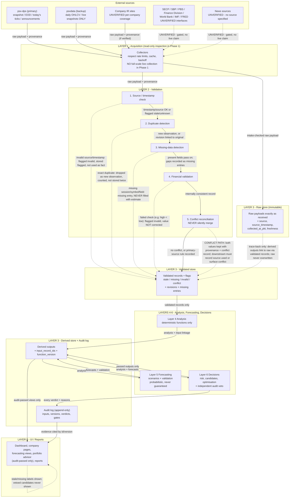

# PSX Intelligence AI — Data Flow Diagram (Phase 1)

**Phase:** 1 of 30 — specification / diagrams only. No application code, no
live data pipeline, no Phase 2 work.

**Canonical diagram file:** [`DATA_FLOW_DIAGRAM.mmd`](DATA_FLOW_DIAGRAM.mmd)
— the `.mmd` file is canonical. The Mermaid code embedded in §2 below is the
**same content, verbatim**, as that file. If the two ever differ, the `.mmd`
file governs and this document must be corrected — do not maintain a second,
conflicting diagram set.

**Budget:** PKR 0 absolute zero-cost (revised brief). No paid hosting, DB,
storage, monitoring, or AI subscription is used or assumed anywhere in this
flow. Local hardware, electricity, and internet are **external operating
expenses** — disclosed here, never called free. No permanent free hosting is
assumed.

**Workflow position (11 stages):** This document belongs to stages 5–7
(architecture planning, implementation specification, documentation) of the
11-stage workflow (see `SYSTEM_ARCHITECTURE.md` §8). Stage 4 in Phase 1 is
**data inspection, read-only only — NO full-scale live data collection**.
This diagram therefore describes how data *will* flow in later phases; it does
not claim that any flow in it has run at scale in Phase 1.

**Verified starting condition (2026-11-04):** Python 3.12.3, Node v24.22.1;
Docker, `psql`, `redis-cli` NOT installed. Data-layer reference scaffold:
`~/workspace/psx-data-collection/` (referenced, never modified) — its
provenance / PKT / stale / conflict rules are the rules this flow implements.
Verified: PSX Data Portal `dps.psx.com.pk`, `psx-dps` (MIT, no API key, ~496
trading vs ~1029 listed, ~5y EOD, today's ticks only, 38 sectors, 224k+
announcements, multi-node 404 quirk), `psxdata` (MIT, PyPI, alpha 0.1.0a1,
daily OHLCV + live snapshots ONLY, no historical intraday archive, 1000+
tickers, 37 sectors). Eulerpool: NO PSX coverage verified, no paid API
approved. SECP / SBP / PBS / Finance Division / World Bank / IMF / FRED:
machine-use **UNVERIFIED** — no endpoint is invented for them anywhere below.

**Hard rules carried into every flow:** raw vs processed separation; provenance
on every record; stale flagged never presented as live; missing recorded never
filled with estimates; conflicts never silently merged; financial numbers only
from deterministic functions, never from an LLM; forecasts probabilistic never
guaranteed; **no real trades** (decision support only).

---

## 1. Provenance fields (required on every record, every store)

| Field | Meaning | If absent |
|---|---|---|
| `source` | Registered source name (e.g. `psx-dps`, `psxdata`, or a named IR/economic source once verified) | Record flagged `invalid`; never used as a fact |
| `source_timestamp` | Timestamp stated by the source, in its own terms, converted to PKT with conversion recorded | `null` + reason; `freshness = unknown`; never shown as live |
| `collected_at_pkt` | When this system collected it, Asia/Karachi (PKT) | Record flagged; collection is not trusted without it |
| `freshness` | `fresh` / `stale` / `unknown`, judged against the source's stated TTL/freshness rule | `unknown` by default; stale/unknown values carry their label to the UI |
| `record_id` | Stable id for this record version | Cannot be cited by derived outputs; not publishable |
| `validation_status` | `valid` / `stale` / `missing` / `invalid` / `conflict` (Layer 2 verdict) | Treated as unvalidated; Layers 4–6 must not use it |
| `input_record_ids` + `function_version` | For derived records only: which stored inputs and which deterministic function version produced the number | Derived number not publishable |

**Timezone rule.** Market timestamps are Asia/Karachi (PKT). A source payload in
another timezone is converted and the conversion recorded; an unconvertible
timestamp flags the record. No timestamp is stored in an ambiguous timezone.

**Raw vs processed separation.**

- **Raw store:** payloads exactly as received, immutable, never overwritten,
  never "cleaned". A later correction is a new version elsewhere, not an edit
  to raw.
- **Validated store:** Layer 2 outputs — validated records, flags, revision
  links, conflict records, missing entries.
- **Derived store:** Layer 4–6 outputs, each linked to input record ids and
  function versions, plus the audit log (append-only).
- A user-facing number must be traceable: UI value → derived record →
  validated records → raw payloads → source. Any break in that chain blocks
  publication.

## 2. Canonical data-flow diagram (verbatim from DATA_FLOW_DIAGRAM.mmd)

**Diagram conventions.** Solid arrows = flows in the Phase 1 design. Dashed
arrows = gated/UNVERIFIED paths, failure/flag side-paths, or trace-back-only
relationships — never read a dashed arrow as a working integration or a
published value.

---

## 3. Walkthrough — every flow

### 3.1 Source → acquisition

1. **psx-dps → Collectors.** Primary market source: snapshot, EOD, today's
   ticks, announcements. Respects the library's claimed rate/cache rules
   (market-aware TTLs, cross-process limit, 429 stop + cooldown per the
   scaffold registry — those claims belong to the library's README, not to a
   live run here) and the multi-node 404 quirk (re-probe, pin a serving node,
   record the node used).
2. **psxdata → Collectors.** Backup: daily OHLCV + live snapshots only. Used
   on primary failure or for cross-checking. Its values are never merged with
   primary values outside Layer 2's conflict path.
3. **Company IR sites → Collectors.** Reports/statements, per-company.
   Coverage UNVERIFIED; a company with no verified sample contributes no
   financial-report flow — the flow for that company is simply absent, not
   approximated.
4. **Economic bodies - - → Collectors (UNVERIFIED, gated).** Dashed because no
   interface is verified. In Phase 1 this flow carries nothing usable; it
   exists so a future verification can attach a real interface without
   redrawing the architecture.
5. **News sources - - → Collectors (UNVERIFIED, gated).** No source specified
   in Phase 1; same gating as (4).

**Phase 1 limit on all of the above:** data inspection is read-only only.
No full-scale live data collection runs in Phase 1. Inspecting a README, a
portal landing page, or a single sample payload to verify a claim is
inspection; running the collector across the market is collection and is out
of Phase 1 scope.

### 3.2 Acquisition → validation (the five checks, in order)

6. **Collectors → Source/timestamp check.** Every payload must carry source,
   source timestamp (or explicit null + reason), collected_at_pkt, freshness.
   Failure → flagged `invalid`, stored flagged in the validated store, never
   used as a fact. A stale-but-valid payload passes onward *flagged stale* —
   staleness is a label, not a deletion.
7. **Source/timestamp check → Duplicate detection.** Key: source +
   symbol/instrument + source timestamp + field set (+ content hash where
   available). Exact duplicate → counted, not stored twice. Changed value for
   the same source timestamp → revision, linked to the original, never an
   overwrite.
8. **Duplicate detection → Missing-data detection.** Present fields pass on;
   every expected-but-absent session/symbol/field becomes a `missing` entry
   (what, for which period/symbol, from which source). Missing is never filled
   — no estimate, interpolation, or prior-period substitution presented as
   observed data.
9. **Missing-data detection → Financial validation.** Deterministic rules
   only (e.g. high ≥ open/close ≥ low; non-negative volumes where required;
   price-change arithmetic consistent with stored values). Failure → flagged
   `invalid`; the value is **not corrected** — correcting a source value would
   destroy the audit trail.
10. **Financial validation → Conflict reconciliation.** Same fact from two
    registered sources compared. No conflict, or a registry primary-source
    rule recorded → record passes to the validated store with that rule noted.
    **Conflict path (dashed):** both values kept with full provenance + a
    conflict record (sources, values, timestamps, applicable rule). Downstream
    must either record which source it used and why, or surface the conflict
    to the user. Averaging, silent picking, or hiding the disagreement is
    forbidden at every downstream layer.

### 3.3 Validation → storage (raw and validated)

11. **Collectors → Raw store (intake-checked).** Raw payloads land immutable
    after Layer 2's intake check. This arrow bypasses no validation for
    *use*: raw is stored for trace-back, but only validated records feed
    analysis. Raw is never overwritten by processed values.
12. **Raw → Validated (trace-back only, dashed).** Derived outputs link back
    through validated records to raw. This is an audit relationship, not a
    second data feed — analysis never reads raw directly.

### 3.4 Validated → analysis → forecasting → decisions

13. **Validated store → Layer 4 Analysis.** Only `valid` records (or
    explicitly flagged records where the flag is itself the subject, e.g. a
    missing-data report). `invalid` records are never silently included.
    Where inputs are missing/flagged, dependent outputs are absent or flagged
    with the reason — e.g. a ratio needing a missing statement field is
    absent, not estimated; an indicator needing 200 validated days with only
    50 available is not computed over 50 silently.
14. **Analysis → Derived store.** Every output carries input record ids,
    function version, computation date (PKT), and limitations, including which
    inputs were missing/flagged.
15. **Derived store → Layer 5 Forecasting (analysis as inputs).** Forecasting
    reads *stored* analysis via Layer 3, not by calling Layer 4 — so any
    forecast is reproducible from stored inputs.
16. **Forecasting → Derived store.** Forecasts with model id/version, inputs,
    assumptions, scenarios, uncertainty/limitations, and validation results
    (backtest / out-of-sample where data allows). A failed validation flags
    the forecast and withholds it from decision use.
17. **Derived store → Layer 6 Decisions.** Analysis + forecasts feed risk,
    recommendation candidates, and proposed allocations. All numbers come
    from deterministic functions; any LLM involvement is limited to drafting
    explanations of stored numbers, never generating numbers.
18. **Decisions → Derived store (passed outputs only).** Only audit-passed
    decision outputs are written back as publishable. Vetoed candidates are
    recorded in the audit log and never written as publishable recommendations.
19. **Decisions → Audit log (every verdict).** Passed / flagged / vetoed, with
    reasons, inputs, and versions — append-only, for every candidate, not just
    published ones.

### 3.5 Derived + audit → UI / reports

20. **Derived store → UI.** Audit-passed views only: dashboard, company pages,
    forecasting views, portfolio advisor, reports. Every figure carries source,
    source timestamp, and freshness.
21. **Audit log → UI (evidence).** Reports cite derived outputs and audit
    records by id/version, so a shown recommendation can be reproduced and its
    audit checked.
22. **UI → UI (guarantee loop, dashed).** The UI's own contract, drawn as a
    self-arrow to make it explicit: stale/missing labels are shown, not
    hidden; vetoed/flagged candidates are never shown; forecasts carry their
    probabilistic label. If upstream data is withdrawn or vetoed later, the UI
    reflects the withdrawal with a reason rather than leaving a stale
    recommendation standing.

## 4. Stale / missing handling — summary table

| Situation | Stored as | Shown as | Never |
|---|---|---|---|
| Source timestamp older than source TTL | `stale` flag on the record | Value + "stale as of <source timestamp>" | Presented as live/current |
| No source timestamp | `freshness = unknown`, `source_timestamp = null` + reason | Value + "timestamp unknown" (or withheld if policy requires) | Called "real-time" because it was fetched recently |
| Expected session/symbol absent | `missing` entry | "Data missing for <period/symbol>" | Filled with estimate/interpolation/prior value |
| Source returns an error / 429 / node 404 | Collection failure telemetry + missing entry where a session was expected | Missing label + reason where applicable | Guessed endpoint, tight retry loop, or silent gap |
| Symbol renamed (e.g. ENGRO → ENGROH) | Explicit rename mapping + both histories linked | History with rename note | Histories silently merged under one symbol |

## 5. Conflict path — worked shape (illustrative, no real values)

A conflict record contains, at minimum: the fact (symbol + field + period),
each source's value, each source's timestamp and collected_at_pkt, the
registry primary-source rule for that field (if one exists), and the
downstream decision (which source was used and why, or "surfaced to user").
Until that decision is recorded, no decision layer may use either value for a
recommendation. The conflict record itself is stored in the validated store
and is visible to operators via Layer 7 monitoring.

## 6. What this flow does NOT do in Phase 1

- No full-scale live collection, no polling loop, no scheduled market ingest
  running in this phase (read-only inspection only).
- No backfill of intraday history (none is publicly available per the verified
  limits), no estimation of missing data.
- No economic/news flow until its interface is verified against an official
  source and registered.
- No trade, broker, payment, or paid-API flow — none exists in this design.

---

*Layer specs: `SYSTEM_ARCHITECTURE.md`. System diagram (canonical .mmd):
`SYSTEM_ARCHITECTURE.mmd` / `SYSTEM_ARCHITECTURE_DIAGRAM.md`. Agent
sequencing: `AGENT_INTERACTION_DIAGRAM.md` (+ `.mmd`). Deployment:
`DEPLOYMENT_ARCHITECTURE.md` (+ `.mmd`). Data-layer reference scaffold:
`~/workspace/psx-data-collection/` (not modified by this phase).*
