# PSX Intelligence AI — Deployment Architecture (Phase 1)

**Phase:** 1 of 30 — deployment *design* / specification only. Nothing in this
document is deployed, installed, or purchased in Phase 1. **STOP AFTER
PHASE 1:** no Phase 2 implementation, installation, or deployment is started
here.

**Canonical diagram file:** [`DEPLOYMENT_ARCHITECTURE.mmd`](DEPLOYMENT_ARCHITECTURE.mmd)
— the `.mmd` file is canonical. The Mermaid code embedded in §2 below is the
**same content, verbatim**, as that file. If the two ever differ, the `.mmd`
file governs and this document must be corrected.

## 0. Budget — PKR 0, absolute (revised brief, governing rule)

- **Budget is PKR 0.** No paid hosting, paid database, paid storage, paid
  monitoring, paid AI subscription, or paid API is used, assumed, or
  recommended in any configuration below. There is no "low-budget cloud" tier
  that spends money: the three configurations in §4 are all zero-cost
  configurations, differing only in *where* zero-cost resources run (single
  local machine vs self-hosted local network vs containerised self-hosted
  design). Any future paid service would need a separate, explicit budget
  approval — it is not authorised by this document.
- **Local hardware, electricity, and internet are EXTERNAL operating
  expenses.** They are real costs borne outside this project's PKR 0 budget
  (e.g. the developer's own machine, power, and connection). They are
  disclosed here and are **never called free**. Saying "free hosting" or
  "free deployment" for a local machine would hide those expenses and is
  forbidden in project communications.
- **No permanent free hosting is assumed.** Free tiers (including GitHub Free,
  in the fixed stack) are current offerings whose terms can change. The design
  therefore keeps code and data portable: the application must run on a local
  machine with no third-party free service, so that withdrawal of any free
  tier degrades convenience, not the ability to run.
- **No purchase is made or implied.** Prices below are labelled
  **VERIFIED** (measured on this machine), **ESTIMATE** (labelled range, not a
  quote), or **UNVERIFIED** (not checked). No hosting price is stated as a
  fact, because no hosting is bought and no vendor quote was obtained.

## 1. Current local reality (verified 2026-11-04 — do not contradict this)

| Item | Status on this machine, 2026-11-04 | Consequence |
|---|---|---|
| Python | **3.12.3 VERIFIED** (`python3 --version`) | Backend / calculation language is available for local dev |
| Node | **v24.22.1 VERIFIED** (`node --version`) | Frontend toolchain runtime is available for local dev |
| Docker / Docker Engine | **NOT installed** (no `docker` binary found) | No container workflow runs locally until Docker Engine is installed (a Phase 2+ step, not done here) |
| PostgreSQL / `psql` | **NOT installed** (no `psql` binary found) | No PostgreSQL instance exists locally; local dev must not assume one |
| Redis / `redis-cli` | **NOT installed** (no `redis-cli` binary found) | No Redis instance exists locally; local dev must not assume one |
| `~/workspace/psx-intelligence-ai/` | New project folder (created for this phase) | Only this team's assigned files are written here; sibling teams' files are not touched |
| `~/workspace/psx-data-collection/` | Existing scaffold, referenced only | **Never overwritten or modified** by this phase; it is the Phase 1 data-layer reference for Layers 1–2 |

**Local-dev alternative (required by the brief, stated here and in §4
Config A).** Until Docker / PostgreSQL / Redis are installed (Phase 2+
decision, with user confirmation), local development uses: **Python venv
(stdlib + project dependencies installed in the venv only), SQLite as the
local-dev database (same logical schema and provenance fields as the
PostgreSQL design, file-local, dev-only), local filesystem + Apache Parquet
files for raw/export storage, no Redis (in-process task handling / direct
function calls for dev), no Docker, and Ollama only if/when installed locally
— otherwise no AI inference in dev.** SQLite local-dev storage is not
production storage and must never be presented as such.

## 2. Canonical deployment diagram (verbatim from DEPLOYMENT_ARCHITECTURE.mmd)

```mermaid
flowchart TB
    subgraph DEV["Local developer machine - VERIFIED 2026-11-04<br/>Python 3.12.3, Node v24.22.1<br/>Docker / psql / redis-cli NOT installed"]
        subgraph FE["Frontend (design)"]
            NEXT["Next.js / React / TypeScript<br/>Tailwind / shadcn"]
        end
        subgraph BE["Backend (design)"]
            FAST["Python / FastAPI / Pydantic<br/>deterministic calculation functions"]
        end
        subgraph DATA["Data (design vs local-dev reality)"]
            PG["PostgreSQL / SQLAlchemy / Alembic<br/>DESIGN TARGET - NOT installed"]
            SQLITE["SQLite (local-dev ONLY)<br/>same logical schema + provenance"]
            PARQ["Local filesystem + Apache Parquet<br/>raw / export store"]
            MINIO["Optional self-hosted MinIO<br/>OPTIONAL, self-hosted only, NOT required"]
            REDIS["Redis (design target)<br/>NOT installed; local-dev: no Redis"]
            OLLAMA["Ollama local inference ONLY<br/>no cloud AI subscription (PKR 0)"]
        end
        subgraph TOOL["Tooling"]
            TEST["Pytest / Playwright<br/>strategy defined, NOT claimed passed"]
            GIT["Git / GitHub Free<br/>free tier, permanence NOT assumed"]
        end
    end
    subgraph CONFIGS["Three zero-cost configurations (PKR 0 - no paid service in any config)"]
        C1["Config A - Zero-cost local<br/>single machine, venv, SQLite, Parquet,<br/>no Docker required"]
        C2["Config B - Zero-cost self-hosted<br/>local network / spare hardware,<br/>Docker Engine when installed, self-hosted only"]
        C3["Config C - Zero-cost scalable design<br/>same self-hosted stack, containerised,<br/>PostgreSQL + Redis when installed;<br/>NO paid cloud assumed"]
    end
    subgraph OPS["Operations - all configs"]
        LOG["Logging / monitoring<br/>self-hosted logs only, no paid monitoring"]
        BACKUP["Backup: DB dump + Parquet + raw store copies<br/>local / self-hosted only"]
        ROLL["Rollback: previous container / code version<br/>+ Alembic downgrade plan (tested, not assumed)"]
        NOTRADE["NO real trades - decision support only<br/>no broker connection in any config"]
    end
    NEXT -->|"API calls (design)"| FAST
    FAST -->|"ORM (design)"| PG
    FAST -->|"local-dev ORM (same schema)"| SQLITE
    FAST -->|"file / Parquet I/O"| PARQ
    FAST -.->|"optional object storage"| MINIO
    FAST -.->|"queue/cache (design only)"| REDIS
    FAST -.->|"local inference only"| OLLAMA
    TEST -.->|"tests backend + frontend"| FAST
    TEST -.->|"tests UI"| NEXT
    GIT -->|"version control"| NEXT
    GIT -->|"version control"| FAST
    C1 -->|"uses"| SQLITE
    C1 -->|"uses"| PARQ
    C2 -->|"uses when installed"| PG
    C2 -->|"uses when installed"| REDIS
    C3 -->|"scales"| PG
    C3 -->|"scales"| REDIS
    LOG -->|"covers"| C1
    LOG -->|"covers"| C2
    LOG -->|"covers"| C3
    BACKUP -->|"protects"| PG
    BACKUP -->|"protects"| SQLITE
    BACKUP -->|"protects"| PARQ
    ROLL -->|"restores"| C1
    ROLL -->|"restores"| C2
    ROLL -->|"restores"| C3
    NOTRADE -.->|"applies to"| C1
    NOTRADE -.->|"applies to"| C2
    NOTRADE -.->|"applies to"| C3
```

**Diagram conventions.** Solid arrows = designed data/control flows. Dashed
arrows = optional, design-only, or invariant relationships (MinIO is optional;
Redis/Ollama are design-target/local-only, not installed; the no-trade rule
applies to every config). No arrow points to a paid cloud, a paid database, a
paid monitoring service, a broker, or a cloud AI API — none exists in this
design.

## 3. Fixed zero-cost stack (revised brief — this is the stack, not a menu)

All components below are **design selections for later phases**, except the
two VERIFIED runtimes. No component version is claimed except Python 3.12.3
and Node v24.22.1; other versions are to be pinned in Phase 2 and are marked
**UNVERIFIED / to-be-pinned** — inventing a version number here would be a
false claim.

| Layer / concern | Fixed stack choice | Status in Phase 1 |
|---|---|---|
| Frontend | Next.js / React / TypeScript / Tailwind / shadcn | Design only; version to-be-pinned; no app built in Phase 1 |
| Backend API | Python / FastAPI / Pydantic | Design only; version to-be-pinned; deterministic calculation functions live here in later phases |
| Database (production design) | PostgreSQL / SQLAlchemy / Alembic | Design target; **NOT installed** locally; migrations are a Phase 2+ artefact |
| Database (local dev) | SQLite (same logical schema + provenance) | Alternative stated in §1; dev-only |
| File / analytical storage | Local filesystem + Apache Parquet | Design; Parquet for raw/export/analytical extracts |
| Object storage | Optional self-hosted MinIO | **Optional only**, self-hosted, never required, never a paid hosted MinIO/cloud storage |
| Queue / cache | Redis | Design target; **NOT installed**; local dev uses no Redis |
| AI inference | Ollama local inference **only** | No cloud AI subscription, no paid AI API, in any config; Ollama itself is not installed/verified in Phase 1 |
| Testing | Pytest / Playwright | Strategy defined in §8; **not claimed passed** for this application (see §8 for the one exception: the separate scaffold's offline tests) |
| Version control / CI host | Git / GitHub Free | Current free tier; permanence NOT assumed; code stays portable to any Git host |
| Containers (later configs) | Docker Engine / local dev (self-hosted) | **NOT installed**; required only for Configs B–C, not for Config A |

**Why this stack fits PKR 0.** Every component above has a zero-cost route:
open-source runtimes/libraries, a local database, local files, self-hosted
services, and local inference. That is a statement about *licensing/cost
route*, not a claim that running them costs nothing overall — hardware,
electricity, and internet remain external operating expenses (§0).

## 4. Three configurations (all PKR 0 — no paid service in any config)

### Config A — Zero-cost local (single machine; the only config runnable today without installs)

- **Runs on:** the developer's own machine (or any single local machine).
- **Uses:** Python venv, Node runtime, SQLite (dev DB), local filesystem +
  Parquet, Git. No Docker, no PostgreSQL, no Redis, no MinIO required.
- **Must be installed for this config (Phase 2+):** project Python
  dependencies in the venv and project Node dependencies only — both from
  their public registries at Phase 2 install time, versions pinned then.
  Nothing else. If a dependency requires a paid licence, it is excluded under
  PKR 0 and an open-source alternative must be chosen.
- **Suits:** development, read-only data inspection, spec validation,
  single-developer testing strategy execution.
- **Does not suit:** multi-user serving, concurrent production load, or any
  claim of production readiness. SQLite concurrency/size limits are a known
  dev-only limitation; hitting them is the signal to move to Config B/C, not
  to silently drop data.
- **Cost:** PKR 0 project spend; hardware/electricity/internet are external
  operating expenses (disclosed, not free).

### Config B — Zero-cost self-hosted (local network / spare hardware)

- **Runs on:** self-hosted hardware the project already has access to (e.g. a
  spare local machine on a local network). No paid cloud, no paid VPS, no
  paid managed database is assumed or recommended.
- **Uses:** the full fixed stack self-hosted — Next.js frontend, FastAPI
  backend, PostgreSQL via SQLAlchemy/Alembic, Redis, local filesystem +
  Parquet, optional self-hosted MinIO, Ollama local inference, Docker Engine
  for containerisation.
- **Must be installed for this config (Phase 2+, in order):** (1) Docker
  Engine; (2) PostgreSQL (containerised or host-installed — installation
  method is a Phase 2 decision, not assumed here); (3) Redis; (4) Ollama
  (only if local AI assistance is wanted; otherwise omit it — the system
  runs without AI inference, since numbers come from deterministic functions);
  (5) MinIO only if object storage is wanted (optional). Each install must be
  verified after install (version + connectivity check) before any config
  claim is made about it.
- **Suits:** shared testing, demo serving on a local network, operator
  monitoring practice.
- **Does not suit:** public internet serving without a separate security
  review (not in Phase 1 scope), or any workload that would require paid
  scaling. Public exposure is out of scope for this design until that review
  exists.
- **Cost:** PKR 0 project spend; hardware/electricity/internet remain
  external operating expenses.

### Config C — Zero-cost scalable design (containerised self-hosted design, not a deployed system)

- **What it is:** the *design* for scaling Config B on self-hosted hardware:
  separate containers for frontend, backend, PostgreSQL, Redis, and (optionally)
  MinIO/Ollama, behind a self-hosted reverse proxy (tool choice is a Phase 2
  decision, not invented here), with the same zero-cost stack throughout.
- **What it is not:** a deployed production system, a cloud architecture, or
  a promise of any traffic/load level. No load, latency, or user-count figure
  is stated, because none has been measured.
- **Must be installed for this config:** everything in Config B, plus
  container orchestration on self-hosted hardware (Docker Engine at minimum;
  any orchestrator beyond that is a Phase 2 decision, not assumed).
- **Scaling lever under PKR 0:** more self-hosted hardware / containers, not
  paid cloud scaling. If self-hosted capacity is exhausted, the honest
  outcome is "capacity reached, scale-out requires hardware" — not a silent
  switch to a paid service.
- **Cost:** PKR 0 project spend; hardware/electricity/internet remain
  external operating expenses, and they grow with self-hosted scale — that
  growth is disclosed, not hidden behind "free".

**Configuration comparison (summary).**

| | A: Local | B: Self-hosted | C: Scalable design |
|---|---|---|---|
| Docker required? | No | Yes (when installed) | Yes |
| Database | SQLite (dev-only) | PostgreSQL | PostgreSQL |
| Redis | No | Yes (when installed) | Yes |
| MinIO | No | Optional self-hosted | Optional self-hosted |
| Ollama | Optional / omitted | Optional local-only | Optional local-only |
| Paid service | None | None | None |
| Runnable today (Phase 1)? | Design only — no app exists yet | No (installs pending) | No (design only) |

## 5. Environments

| Environment | Purpose | Data | Config |
|---|---|---|---|
| Local dev | Development, inspection, testing-strategy execution | SQLite file + Parquet extracts; **no real user data, no production market feed as a service** | Config A |
| Self-hosted test | Shared testing, demo on local network | Separate PostgreSQL/Redis instances from any demo data; seeded/sample data only unless a later phase defines otherwise | Config B |
| Self-hosted "production-like" design | Design target for later phases; not deployed in Phase 1 | No environment exists in Phase 1; data rules (raw immutable, provenance, audit log) apply whenever it is built | Config C design |

**Environment separation rules.** Dev, test, and production-like data stores
are never shared. A migration, seed, or test run in one environment never
touches another environment's store. Credentials/secrets (if any exist in
later phases) are environment-scoped and never committed to Git — Phase 1
creates no credentials at all, so there is nothing to rotate here.

## 6. CI/CD outline (GitHub Free — free tier, permanence not assumed)

Design outline only; no pipeline is built or run in Phase 1. The outline uses
GitHub Free as the version-control/CI host because it is in the fixed stack,
with the portability note from §0: every step below must also be runnable
locally (same commands, no host-only magic), so losing the free tier costs
convenience, not the pipeline itself.

1. **Push / pull request** → lint + type checks (frontend: TypeScript;
   backend: Python lint/type checks — exact tools pinned in Phase 2).
2. **Unit tests** → Pytest (backend, deterministic functions first: every
   financial function gets input/output cases, including stale/missing/
   conflict inputs, before any UI test).
3. **Frontend tests** → Playwright (UI flows: dashboard, company page,
   forecasting view, advisor — asserting labels: stale/missing shown, forecast
   labelled probabilistic, vetoed candidates absent).
4. **Build** → frontend build + backend package build; build failure blocks
   merge (no "merge and fix later" for a financial-data system).
5. **Self-hosted deploy (Configs B/C only, later phases)** → deploy the
   built containers to self-hosted hardware via a recorded, reversible step
   (§9 rollback). No deploy step targets a paid cloud.
6. **Post-deploy checks** → health endpoints, DB migration status (Alembic
   current), audit-log writability, and a provenance smoke check (one stored
   record traces UI → derived → validated → raw). Failure → rollback (§9).

**What CI/CD never does in this design:** run full-scale live data collection,
execute trades, publish an unaudited recommendation, spend money, or use a
paid service. A pipeline step that would do any of those is a design violation
and must be removed, not "gated".

## 7. Logging and monitoring (self-hosted only, no paid monitoring)

- **Logs:** structured application logs (task id, layer, outcome, reason) to
  local files / self-hosted log storage in Configs B/C; plain files in
  Config A. Logs contain no credentials, no API keys (none exist in Phase 1),
  and no personal financial data beyond what the design already stores.
- **Monitoring (operator-facing, not user-facing):** task success/failure
  counts, source health per Layer 1 telemetry, validation failure rates,
  audit veto/flag rates, data freshness (oldest validated record per source),
  storage size, and (Configs B/C) container/DB/Redis health. All of this is
  computed from local logs/stores with open-source or built-in tooling —
  **no paid monitoring service** (no paid APM, log host, or alerting vendor)
  is used or assumed. Alerting in later phases is via self-hosted means
  (tool choice Phase 2) or operator review of the admin monitoring view.
- **What monitoring must surface first:** a sustained source failure, a
  conflict storm, a validation failure spike, or a veto spike — each as an
  operator alert, not a silent log line (see Layer 7 in the architecture doc).

## 8. Testing strategy — defined, NOT claimed passed

**This application's testing is a strategy defined in Phase 1, not a result.**
No application exists in Phase 1, so no application test has passed, and none
is claimed passed here. The single exception, stated precisely to avoid
over-claiming: the *separate* scaffold at `~/workspace/psx-data-collection/`
has offline tests (`test_collector_offline.py`, fake client, no network, no
PSX call) that were passing when that scaffold was delivered — that is a fact
about the scaffold, not about this application, and it does not transfer to
any claim about this system.

**Strategy (to be executed in later phases):**

- **Unit (Pytest):** every deterministic financial function — fixed
  input/output cases, edge cases (zero/negative/missing inputs, stale and
  conflict-flagged inputs), and reproducibility (same inputs + version =
  same output). LLM paths are never unit-tested for "correct numbers" —
  numbers are function outputs.
- **Validation (Pytest, offline fixtures):** all five Layer 2 checks against
  fixture payloads (duplicate, revision, missing, invalid OHLC, conflict) —
  asserting flags and conflict records, not silent merges or corrections.
- **Integration (Pytest + local stores):** Layer 1→2→3→4→5→6→8 chain on
  fixture data in SQLite (Config A) and, when installed, PostgreSQL
  (Configs B/C) — asserting provenance chain integrity end to end.
- **UI (Playwright):** user flows asserting the UI guarantees — stale/missing
  labels visible, forecasts labelled probabilistic, vetoed/flagged candidates
  absent from advisor views, reports citing stored ids.
- **Audit-path tests:** veto blocks publication; flagged requires gate;
  gate rejection keeps output unpublished; retry rules (§5 of the agent
  interaction doc) — including "veto is not retried".
- **Migration tests (Alembic, later phases):** upgrade + downgrade on a copy
  of the schema, asserting raw/provenance columns are never dropped.
- **No live-market test dependency:** no test requires a live PSX call, a
  paid API, or a broker. Tests that need market-shaped data use fixtures.

## 9. Backup and rollback

**Backup (all configs, local/self-hosted only — no paid backup service).**

- **What is backed up:** database dump (SQLite file copy in Config A;
  PostgreSQL dump in Configs B/C), Parquet/raw-store copies, and the audit
  log (which is append-only and must be backed up with the same care as the
  data it evidences). Configuration (registry, schedules, rules) is backed up
  as versioned files in Git, not only as live DB rows.
- **Frequency/retention:** to be set in Phase 2 operations runbook (not
  invented here). The design constraint is: backup frequency must be at least
  as often as the data changes in a way that would be costly to re-derive,
  and a backup is only a backup if a restore has been tested (see below).
- **Restore test:** restoring a backup to an isolated environment and
  running the provenance smoke check (§6 step 6) is part of the strategy,
  not an assumed success.

**Rollback.**

- **Code/container rollback:** redeploy the previous Git-tagged version /
  previous container image (Configs B/C); re-run the previous local checkout
  (Config A). Every deploy is tagged so "previous" is unambiguous.
- **Database rollback:** Alembic downgrade plan for the migration being
  rolled back — the downgrade must be *tested* on a copy before it is relied
  on (a downgrade that drops provenance columns or rewrites raw data is
  forbidden and must be redesigned, not run).
- **Data rollback rule:** rollback never rewrites raw payloads or the audit
  log. If a bad derived output was published, it is withdrawn with a recorded
  reason (superseding record), not deleted from history.
- **Rollback trigger:** failed post-deploy checks (§6), a veto spike caused
  by a bad rule change, or a validation failure spike after a deploy — any
  of these triggers rollback consideration by the operator, not automatic
  silent rollback of financial data.

## 10. Operation notes — including the no-trade invariant

- **The system must NOT execute real trades initially.** This is a design
  invariant across all configs and all phases covered by this document: there
  is no broker connection, no order-placement path, no execution branch in
  the audit flow, and no UI element that places an order. Decision outputs
  are candidates and proposed allocations for human review only. Any future
  proposal to add execution would be a new design decision requiring separate
  approval, a broker/licence review, and a new audit design — it cannot be
  added as a "small" change to this architecture.
- **No live polling in Phase 1.** No collector loop, scheduler, or market
  ingest runs as part of this phase. Later-phase schedules are Layer 7
  configuration, bounded by source rate limits, with backoff and 429 stops.
- **Licensing note (carried from the scaffold).** Do not bypass
  authentication, access controls, or rate limits. Do not resell or republish
  a live PSX feed without verifying PSX licensing first. The libraries'
  "not legal advice" notes are not a licence.
- **Forecast/recommendation labelling in operation.** Every served forecast
  and recommendation carries its evidence, inputs, date, and limitations in
  the UI. An operator must not remove those labels for presentation reasons.
- **Zero-cost operations discipline.** If a future need appears that only a
  paid service can meet, the project stops at that need and seeks a budget
  decision — it does not quietly adopt the paid service and re-label the
  budget. Local hardware/electricity/internet costs are tracked as external
  operating expenses, not absorbed into a "free" claim.

## 11. 11-stage workflow — where Phase 1 sits (and where it stops)

The fixed workflow for this project, with Phase 1's position marked:

1. **Brainstorm** — Phase 1 (this architecture's scope, layers, and rules).
2. **Research** — Phase 1 (verified sources reused from the scaffold registry;
   UNVERIFIED items explicitly listed, not researched into false claims).
3. **Validate** — Phase 1 (validation rules, conflict rules, and audit rules
   specified; live claims validated only where the scaffold already verified
   them).
4. **Data inspection, read-only only** — Phase 1 limit: inspect READMEs,
   portal pages, and sample shapes; **NO full-scale live data collection**.
5. **Architecture planning** — Phase 1 (this document set).
6. **Implementation specification** — Phase 1 (layer contracts, message
   shapes, stack, deployment design — specifications, not code).
7. **Documentation** — Phase 1 (this document set, including canonical
   `.mmd` diagrams).
8. **Testing strategy defined, not claimed passed** — Phase 1 (§8 above).
9. **Independent audit** — Phase 1 (audit *design*: independent audit agent
   + veto path specified; audit of a built system belongs to later phases).
10. **Correction** — Phase 1 (this revision: PKR 0 budget, canonical `.mmd`
    files, fixed stack, no-trade invariant — corrections applied to the
    Phase 1 docs themselves, not to a built system).
11. **Checkpoint** — Phase 1 ends here. **STOP AFTER PHASE 1.** No Phase 2
    code, install, deployment, or live collection begins until a separate
    instruction starts it.

## 12. UNVERIFIED / ESTIMATE register for this document

| Item | Status | Why it matters |
|---|---|---|
| PostgreSQL, Redis, Docker Engine availability locally | NOT installed (verified 2026-11-04) | Configs B/C cannot run until installed + verified |
| Ollama availability / version | UNVERIFIED (not installed/checked in Phase 1) | Local AI route exists in design only until installed |
| MinIO need / version | Optional, UNVERIFIED need | Never required; do not assume it |
| Next.js / FastAPI / Pydantic / SQLAlchemy / Alembic / Tailwind / shadcn versions | To-be-pinned in Phase 2 (UNVERIFIED) | No version is claimed |
| Any hosting/cloud price | No price stated; any future figure must be ESTIMATE or UNVERIFIED, never a quote | PKR 0 budget forbids assuming a paid tier |
| SECP / SBP / PBS / Finance Division / World Bank / IMF / FRED interfaces | UNVERIFIED | Economic flow is a gated slot only |
| News source | UNVERIFIED — none specified | News flow is a gated slot only |
| Eulerpool PSX coverage | NOT verified; vendor only; no paid API approved | Eulerpool is not a source in this design |
| Production load / latency / user counts | UNVERIFIED — none measured, none stated | Config C is a design, not a capacity claim |
| GitHub Free permanence | NOT assumed (terms can change) | Portability (§0, §6) is the mitigation |

---

*Layer specs: `SYSTEM_ARCHITECTURE.md`. System diagram (canonical .mmd):
`SYSTEM_ARCHITECTURE.mmd` / `SYSTEM_ARCHITECTURE_DIAGRAM.md`. Data flows:
`DATA_FLOW_DIAGRAM.md` (+ `.mmd`). Agent sequencing:
`AGENT_INTERACTION_DIAGRAM.md` (+ `.mmd`). Data-layer reference scaffold:
`~/workspace/psx-data-collection/` (not modified by this phase).*
