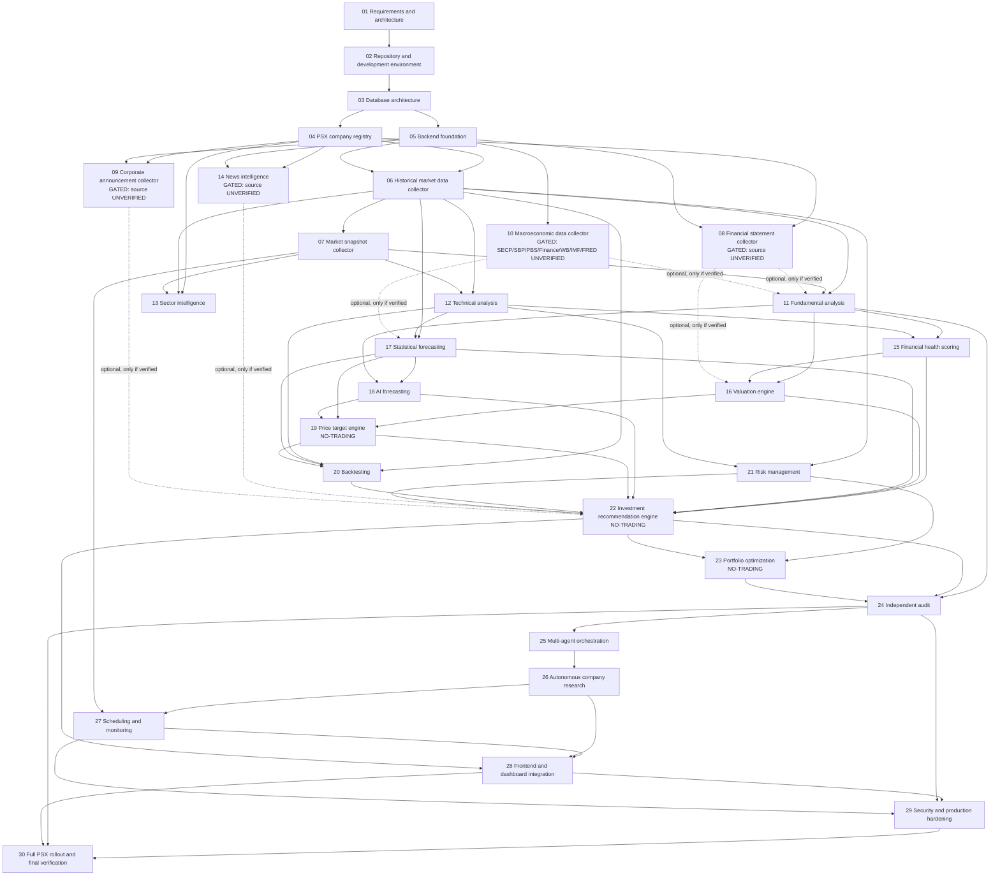

# PSX Intelligence AI — Phase Dependency Map

> Canonical phase list: `MASTER_ROADMAP.md` (docs version). Phase numbers
> and names below match it exactly, in order. Hard dependencies mean the
> phase cannot complete without the predecessor's outputs. Soft/optional
> dependencies mean the phase proceeds without that input, with reduced
> coverage, and uses it only if available. UNVERIFIED-gated means data
> ingestion (not framework design) is blocked until a source verifies.

## Dependency table

| Phase | Hard dependencies | Soft / optional dependencies | UNVERIFIED-gated? |
|---|---|---|---|
| 01 Requirements and architecture | — | Scaffold (read-only reference) | No — but it records all UNVERIFIED items |
| 02 Repository and development environment | 01 | — | No |
| 03 Database architecture | 01, 02 | — | No |
| 04 PSX company registry | 01, 02, 03 | 05 (loader conventions; model does not wait for 05) | No (verified symbol/sector data only) |
| 05 Backend foundation | 01, 02, 03 | 04 (parallel work allowed) | No |
| 06 Historical market data collector | 02, 03, 04, 05 | — | No for `psx-dps`/`psxdata` EOD; historical intraday is unavailable (no verified source) — not a dependency, a scope limit |
| 07 Market snapshot collector | 03, 04, 05, 06 | — | No for verified snapshots; market-calendar feed UNVERIFIED (neutral reporting fallback) |
| 08 Financial statement collector | 03, 04, 05 | — (framework only until gate clears) | **YES — data ingestion gated:** no verified machine-readable statement source asserted |
| 09 Corporate announcement collector | 03, 04, 05 | — (framework only until gate clears) | **YES — data ingestion gated:** no verified machine-readable announcement source asserted |
| 10 Macroeconomic data collector | 03, 05 | — (framework only until gate clears) | **YES — data ingestion gated:** SECP / SBP / PBS / Finance Division / World Bank / IMF / FRED machine-use UNVERIFIED, per series |
| 11 Fundamental analysis | 04, 06, 07 | 08, 10 (only if verified) | Partially — proceeds on verified PSX data alone if 08/10 stay gated |
| 12 Technical analysis | 06, 07 | — | No |
| 13 Sector intelligence | 04, 06, 07 | 11 | No |
| 14 News intelligence | 03, 04, 05 | — (framework only until gate clears) | **YES — data ingestion gated:** no verified, lawfully usable news source asserted |
| 15 Financial health scoring | 11, 12 | 13 | Partially — inherits 08/10 gaps via 11 |
| 16 Valuation engine | 11, 15 | 08 (only if verified) | Partially — withholds/range-bounds where inputs missing |
| 17 Statistical forecasting | 06, 11, 12, 13 | 10 (only if verified) | Partially — baselines must work on verified PSX data alone |
| 18 AI forecasting | 11, 12, 13, 15, 16, 17 | — | No new source; inherits upstream gaps; free/local AI only (PKR 0) |
| 19 Price target engine | 12, 16, 17, 18 | — | No — plus no-trade guard (not a dependency, a prohibition) |
| 20 Backtesting | 06, 12, 17, 18, 19 | — | No — EOD only (intraday unavailable) |
| 21 Risk management | 06, 12, 13, 17 | — | No |
| 22 Investment recommendation engine | 11, 12, 13, 15, 16, 17, 18, 19, 20, 21 | 08, 09, 10, 14 (only if verified) | Partially — recommendations computed on verified inputs alone if gated phases stay closed |
| 23 Portfolio optimization | 04, 06, 12, 21, 22 | — | No — plus no-trade guard |
| 24 Independent audit | 02–23 | — | Audits all UNVERIFIED items; does not resolve them by assumption |
| 25 Multi-agent orchestration | 05, 11–23, 24 | — | No new source; agents consume audited layers only |
| 26 Autonomous company research | 04, 06–23, 24, 25 | 08, 09, 10, 14 (only if verified) | Partially — dossiers label gaps where gated inputs are missing |
| 27 Scheduling and monitoring | 05, 06, 07, 25, 26 | — | No |
| 28 Frontend and dashboard integration | 04, 06–23, 26, 27 | — | Inherits all upstream gaps as labelled gaps on-screen |
| 29 Security and production hardening | 02, 03, 05, 24, 27, 28 | — | No — licence register may surface a use that must be removed |
| 30 Full PSX rollout and final verification | 24, 25, 26, 27, 28, 29 | — | Final verification must list every still-UNVERIFIED item as open; online deployment conditional on a verified free service (permanent-free-hosting caveat) |

## Mermaid diagram

Reading note: dashed arrows are optional inputs. A dashed arrow that never
materialises does not block its target — the target proceeds with a
documented limitation, per `PHASE_BREAKDOWN.md`.

## Critical path

The longest hard-dependency chain that determines the earliest possible
completion order is:

**01 → 02 → 03 → 05 → 06 → 12 → 17 → 18 → 19 → 20 → 22 → 24 → 25 → 26 →
27 → 28 → 29 → 30**

with the registry chain **03 → 04 → 06** and the analysis chain
**11 → 15 → 16 → 22** running in parallel with it and joining at Phase 22
and Phase 24. Phases 08, 09, 10, and 14 are **off the critical path by
design**: their framework work can run in parallel with Phases 06–07, but
their data ingestion must never be waited on — downstream phases proceed
without them if verification fails, so a gated source cannot stall the
programme.

## Phases blocked (in whole or part) by UNVERIFIED sources

| Phase | What is blocked | What proceeds anyway |
|---|---|---|
| 08 Financial statement collector | Statement data ingestion | Framework, field model, verification checklist, missing-field rules |
| 09 Corporate announcement collector | Announcement data ingestion | Framework, announcement model, verification checklist, deduplication rules |
| 10 Macroeconomic data collector | Macro series ingestion (per series; SECP, SBP, PBS, Finance Division, World Bank, IMF, FRED each separately) | Framework, series model, per-source checklist, revision policy, no-macro fallback |
| 14 News intelligence | News data ingestion | Framework, taxonomy, verification checklist, classification rules on fixtures |
| 11, 15, 16, 17, 22, 26 (partially) | The gated inputs only — not the phase | Full computation on verified PSX data alone, with gaps labelled |

No other phase is blocked by an unverified source. In particular, Phases
06 and 07 proceed on the verified `psx-dps` / `psxdata` sources, and Phase
30's online deployment is conditional (verified free service only), not
blocked — local rollout is always available.

## Parallel-work guidance

- Phases 04 and 05 may run in parallel once Phase 03's schema exists.
- Phases 08, 09, 10, 14 (framework + checklist) may run in parallel with
  Phases 06–07.
- Phases 12 and 13 may run in parallel once Phases 06–07 deliver data.
- Phases 25–27 are sequential (orchestration → research → scheduling),
  not parallel, because each consumes the previous one's gates/logs.
- Phase 24 (audit) must not overlap with implementation of the items it
  audits; it starts after Phases 02–23 outputs are frozen for audit.
