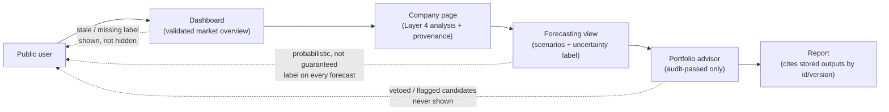
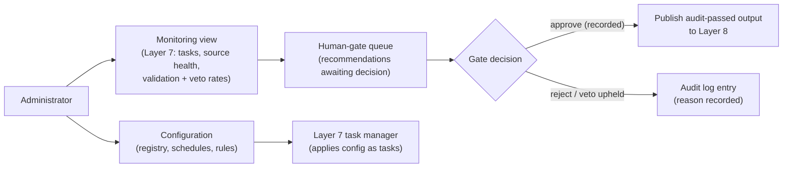

# PSX Intelligence AI — System Architecture Diagram (Phase 1)

**Phase:** 1 of 30 — specification / diagrams only. No application code, no
Phase 2 work. See `SYSTEM_ARCHITECTURE.md` for the full layer specifications
that these diagrams summarise.

**Reading note.** Mermaid diagrams below are architecture diagrams, not a
running system. Boxes labelled **UNVERIFIED** are design slots whose interface
has not been verified against an official source; no endpoint, field, or
coverage is asserted for them. Nothing in these diagrams is a live connection,
a purchase, or a broker link.

**Canonical diagram file:** [`SYSTEM_ARCHITECTURE.mmd`](SYSTEM_ARCHITECTURE.mmd)
— the `.mmd` file is canonical. The Mermaid code in §1 below is the **same
content, verbatim**, as that file. If the two ever differ, the `.mmd` file
governs and this document must be corrected — do not maintain two conflicting
diagram sets. The user/admin flow diagrams in §§3–4 are supplementary views of
the same system, not separate canonical diagrams, and they introduce no new
layer, source, or flow.

**Revised brief (merged 2026-11-04):** Budget is **PKR 0 absolute zero-cost**
— no paid hosting/DB/storage/monitoring/AI subscription in any configuration;
local hardware, electricity, and internet are external operating expenses,
disclosed, never called free; no permanent free hosting is assumed. Fixed
zero-cost stack (design only, versions to-be-pinned except Python 3.12.3 /
Node v24.22.1 VERIFIED): Next.js/React/TypeScript/Tailwind/shadcn,
Python/FastAPI/Pydantic, PostgreSQL/SQLAlchemy/Alembic, local filesystem +
Apache Parquet + optional self-hosted MinIO, Redis, Ollama local inference
only, Pytest/Playwright, Git/GitHub Free, Docker Engine/local dev. Docker,
`psql`, `redis-cli` are NOT installed — local-dev alternative is SQLite
(dev-only), Python venv, no Docker required. **The system must NOT execute
real trades initially** — decision support only, no broker connection.
Workflow: 11 stages (see `SYSTEM_ARCHITECTURE.md` §8); Phase 1 data inspection
is read-only only, NO full-scale live data collection. **STOP AFTER PHASE 1.**

**Verified starting condition (2026-11-04):** Python 3.12.3, Node v24.22.1;
Docker, `psql`, `redis-cli` NOT installed. Data-layer reference scaffold:
`~/workspace/psx-data-collection/` (referenced, never modified). Verified
sources: PSX Data Portal `dps.psx.com.pk`, `psx-dps` (MIT, no API key), `psxdata`
(MIT, PyPI, alpha 0.1.0a1). Eulerpool: NO PSX coverage verified, no paid API
approved. SECP / SBP / PBS / Finance Division / World Bank / IMF / FRED:
machine-use UNVERIFIED.

---

## 1. Full system diagram — all 8 layers, external sources, users

```mermaid
flowchart TB
    subgraph EXT["External sources - outside system boundary"]
        direction TB
        PSXPORTAL["PSX Data Portal<br/>dps.psx.com.pk<br/>VERIFIED portal exists; endpoints undocumented"]
        PSXDPS["psx-dps library (MIT, no API key)<br/>~496 trading vs ~1029 listed; ~5y EOD;<br/>today's ticks only; 38 sectors; 224k+ announcements"]
        PSXDATA["psxdata library (MIT, PyPI, alpha 0.1.0a1)<br/>daily OHLCV + live snapshots ONLY;<br/>no historical intraday archive; 1000+ tickers; 37 sectors"]
        EULER["Eulerpool - VENDOR ONLY<br/>NO PSX coverage verified<br/>No paid API approved - PKR 0 budget"]
        IR["Listed-company investor-relations sites<br/>UNVERIFIED per-company machine coverage"]
        ECON["SECP / SBP / PBS / Finance Division /<br/>World Bank / IMF / FRED<br/>UNVERIFIED interfaces - no endpoints asserted"]
        NEWS["News sources<br/>UNVERIFIED - no source specified in Phase 1"]
    end
    subgraph L1["LAYER 1 - Data Acquisition (only layer touching external sources)"]
        direction LR
        C_MKT["Market collectors<br/>(snapshot, quote)"]
        C_HIST["Historical collector<br/>(EOD only)"]
        C_FIN["Financial-report collector<br/>(coverage UNVERIFIED)"]
        C_ANN["Announcement collector<br/>(PDF URLs; extraction UNVERIFIED)"]
        C_ECO["Economic collector<br/>(UNVERIFIED slot)"]
        C_NEWS["News collector<br/>(UNVERIFIED slot)"]
    end
    subgraph L2["LAYER 2 - Data Validation"]
        V["Source/timestamp validation<br/>Duplicate detection<br/>Missing-data detection<br/>Financial validation<br/>Conflict reconciliation<br/>(NEVER silently merge)"]
    end
    subgraph L3["LAYER 3 - Storage - zero-cost stack<br/>PostgreSQL / SQLAlchemy / Alembic (production design)<br/>Local FS + Apache Parquet + optional self-hosted MinIO"]
        direction LR
        RAW["Raw store<br/>(immutable payloads)"]
        VAL["Validated store<br/>(records, flags, conflicts)"]
        DER["Derived store<br/>(analysis, forecasts, decisions)"]
        AUD["Audit log<br/>(append-only)"]
    end
    subgraph L4["LAYER 4 - Financial Analysis<br/>Python / FastAPI / Pydantic (API design)"]
        A["Fundamental - Technical - Sector<br/>Macro (UNVERIFIED inputs) - Health scoring - Valuation<br/>Deterministic functions only"]
    end
    subgraph L5["LAYER 5 - Forecasting<br/>Ollama local inference ONLY for AI assistance"]
        F["Statistical - Quantitative<br/>AI-assisted research (no LLM numbers)<br/>Scenarios - Validation<br/>Probabilistic, never guaranteed"]
    end
    subgraph L6["LAYER 6 - Investment Decisions<br/>NO real trades - decision support only"]
        direction LR
        RISK["Risk assessment"]
        REC["Recommendation engine<br/>(candidates only)"]
        PORT["Portfolio optimisation<br/>(proposed, not executed)"]
        AUDIT["Independent audit<br/>VETO path"]
    end
    subgraph L7["LAYER 7 - Agent Orchestration<br/>Redis (design target, NOT installed locally)"]
        O["Registry use - Task manager<br/>Communication - Scheduling<br/>Retries (bounded) - Monitoring - Cost control"]
    end
    subgraph L8["LAYER 8 - User Interface<br/>Next.js / React / TypeScript / Tailwind / shadcn (design)"]
        direction LR
        PUB["Public site - Dashboard<br/>Company pages - Forecasting views"]
        ADV["Portfolio advisor<br/>(audit-passed only) - Reports"]
        ADM["Admin<br/>(monitoring, gates, config)"]
    end
    USER["Public user"]
    ADMIN["Administrator / operator"]
    HUMAN["Human gate reviewer<br/>(recommendation approval)"]
    PSXPORTAL -->|"portal data via library"| C_MKT
    PSXDPS -->|"primary market snapshot / EOD / ticks / announcements"| C_MKT
    PSXDPS -->|"EOD history; today's ticks"| C_HIST
    PSXDPS -->|"announcement list + PDF URLs"| C_ANN
    PSXDATA -->|"backup daily OHLCV / live snapshots"| C_MKT
    PSXDATA -->|"backup EOD history"| C_HIST
    EULER -.->|"NOT USED in Phase 1<br/>no PSX coverage verified"| C_MKT
    IR -->|"reports/statements (per-company, UNVERIFIED)"| C_FIN
    ECON -.->|"UNVERIFIED - gated slot, no live claim"| C_ECO
    NEWS -.->|"UNVERIFIED - no source specified"| C_NEWS
    C_MKT -->|"raw payloads + provenance"| V
    C_HIST -->|"raw payloads + provenance"| V
    C_FIN -->|"raw payloads + provenance"| V
    C_ANN -->|"raw payloads + provenance"| V
    C_ECO -->|"raw payloads + provenance (if ever verified)"| V
    C_NEWS -->|"raw payloads + provenance (if ever verified)"| V
    V -->|"validated / flagged / conflict records"| VAL
    V -->|"raw payloads (intake-checked)"| RAW
    VAL -->|"validated records only"| A
    A -->|"analysis outputs + input linkage"| DER
    DER -->|"analysis as forecast inputs"| F
    F -->|"forecast outputs + validation"| DER
    DER -->|"analysis + forecasts"| RISK
    DER -->|"analysis + forecasts"| REC
    RISK -->|"risk outputs"| REC
    RISK -->|"risk outputs"| PORT
    REC -->|"recommendation candidates"| AUDIT
    PORT -->|"proposed allocations"| AUDIT
    AUDIT -->|"passed / flagged / vetoed + reasons"| AUD
    AUDIT -->|"passed outputs only"| DER
    DER -->|"audit-passed views"| PUB
    DER -->|"audit-passed recommendations"| ADV
    AUD -->|"audit evidence for reports"| ADV
    O -->|"collection tasks"| C_MKT
    O -->|"collection tasks"| C_HIST
    O -->|"validation tasks; failure alerts back"| V
    O -->|"analysis / forecast / decision tasks (in dependency order)"| A
    O -->|"analysis / forecast / decision tasks"| F
    O -->|"decision tasks; veto/flag alerts back"| REC
    O -->|"monitoring + human-gate tasks"| ADM
    O -->|"human-gate requests"| HUMAN
    HUMAN -->|"gate decisions (recorded)"| O
    HUMAN -->|"gate decisions (recorded)"| AUD
    USER -->|"browse (read-only)"| PUB
    USER -->|"browse (read-only)"| ADV
    ADMIN -->|"operate (via Layer 7 tasks, never direct DB edits)"| ADM
    ADM -->|"task requests"| O
    VAL -.->|"read (validated only)"| F
    VAL -.->|"read (validated only)"| RISK
```

**Diagram conventions.** Solid arrows = data or task flow that exists in the
Phase 1 design. Dashed arrows (`-.->`) = gated, UNVERIFIED, or read-only
relationships that must not be read as working integrations. The Eulerpool
dashed arrow is explicitly **NOT USED** in Phase 1. There is no arrow from any
layer to a broker, a payment service, or a paid API — none exists in Phase 1.

---

## 2. Walkthrough — every arrow, in order

### 2.1 External sources → Layer 1 (the only external boundary)

1. **PSX Data Portal → Market collectors.** The portal is the underlying
   source the libraries read. The portal itself publishes no official public
   API/documentation (per the psx-dps FAQ, via the scaffold registry), so
   endpoints can change without notice. Layer 1 must therefore treat portal
   access as fragile and always have a fallback path recorded.
2. **psx-dps → Market collectors (primary).** Whole-market snapshot and live
   quotes, claimed ~496 trading symbols. Carries the multi-node 404 quirk:
   a 404 from one node means "wrong node", not "no data" — re-probe and pin a
   serving node, and record which node served the data.
3. **psx-dps → Historical collector.** ~5 years EOD per symbol. Today's ticks
   only — not a historical intraday archive. Any request for historical
   intraday bars must fail with that reason, not be approximated from EOD.
4. **psx-dps → Announcement collector.** Announcement list with PDF URLs
   (224k+ claimed). A PDF URL is the output here; extracting and validating
   PDF content is a separate, UNVERIFIED step and is not claimed.
5. **psxdata → Market collectors (backup).** Daily OHLCV and live snapshots.
   Backup means: used when the primary fails or for cross-checking, under the
   conflict rules of Layer 2 — never silently merged with primary values.
6. **psxdata → Historical collector (backup).** Daily OHLCV history. Same
   limit as above: no historical intraday archive (stated explicitly in the
   psxdata README).
7. **Eulerpool - - → Market collectors (NOT USED).** Dashed and labelled, to
   make the exclusion visible: Eulerpool is a vendor API with no verified PSX
   coverage and no paid API approved in Phase 1. No arrow may be treated as an
   integration until a separate coverage/licensing check passes.
8. **Investor-relations sites → Financial-report collector.** Per-company
   annual/quarterly reports and statements. Coverage and machine-readable
   format are UNVERIFIED per company; no company is claimed covered until a
   live sample check documents it.
9. **SECP / SBP / PBS / Finance Division / World Bank / IMF / FRED - - →
   Economic collector (UNVERIFIED slot).** The collector exists as a named
   design slot so the architecture is complete, but no interface, endpoint,
   field, or frequency is asserted for any of these bodies. The slot is gated:
   it produces nothing usable until verification.
10. **News sources - - → News collector (UNVERIFIED slot).** No news source is
    specified in Phase 1. Any future source needs its own registry entry
    (source, licence, freshness, limits) before this arrow becomes solid.

### 2.2 Layer 1 → Layer 2

11. **Each collector → Validation.** Every collector emits the same shape:
    raw payload (unmodified) + `source`, `source_timestamp`,
    `collected_at_pkt`, `freshness`, collector identity, and telemetry. Layer 1
    performs no content validation beyond transport integrity; that is Layer 2's
    job. This separation is what keeps a corrupt payload from entering storage
    as if valid.

### 2.3 Layer 2 → Layer 3

12. **Validation → Validated store.** Validated records, flagged records
    (`stale`, `missing`, `invalid`), revision links, and conflict records.
    Invalid records are stored flagged, not discarded, so failures are auditable.
13. **Validation → Raw store (intake-checked).** Raw payloads are stored
    immutably after Layer 2's intake check. Raw is never overwritten by
    processed values, and processed values never replace raw.

### 2.4 Layer 3 → Layer 4 → Layer 3 → Layer 5 → Layer 3

14. **Validated store → Financial Analysis.** Analysis reads **only** validated
    records (with status filtering). It never reads raw payloads directly and
    never contacts an external source. This is the key boundary that prevents
    unvalidated numbers from reaching users.
15. **Financial Analysis → Derived store.** Analysis outputs with input record
    ids, function version, computation date (PKT), and limitations — including
    which inputs were missing/flagged.
16. **Derived store → Forecasting (analysis as inputs).** Forecasting reads
    stored analysis (via Layer 3), not by calling Layer 4 directly, so a
    forecast is reproducible from stored inputs.
17. **Validated store - - → Forecasting (read, validated only).** Forecasting
    may also read validated records directly from Layer 3 for series it models
    itself; the same validation-status contract applies.
18. **Forecasting → Derived store.** Forecast outputs with model id/version,
    inputs, assumptions, scenarios, uncertainty, and validation results.

### 2.5 Layer 3 → Layer 6 (decisions) and the audit path

19. **Derived store → Risk assessment.** Risk reads stored analysis +
    forecasts.
20. **Derived store → Recommendation engine.** Same inputs as risk.
21. **Risk → Recommendation engine.** Risk outputs feed the recommendation
    candidate (a candidate is not yet a publishable recommendation).
22. **Risk → Portfolio optimisation.** Risk outputs constrain/parameterise the
    proposed allocation.
23. **Recommendation engine → Independent audit.** Every candidate goes to
    audit before any user sees it. There is no path from the recommendation
    engine to Layer 8 that bypasses audit.
24. **Portfolio optimisation → Independent audit.** Proposed allocations are
    audited on the same path.
25. **Independent audit → Audit log.** Every verdict (`passed`, `flagged`,
    `vetoed`) with reasons, inputs, and function versions — append-only.
26. **Independent audit → Derived store (passed outputs only).** Only passed
    outputs are written back as publishable decision outputs. A vetoed
    candidate is recorded in the audit log but never written as a publishable
    recommendation.
27. **Audit log → Portfolio advisor / reports (evidence).** Reports cite audit
    evidence by id/version so a shown recommendation can be traced to its audit.

### 2.6 Layer 3 → Layer 8 (user-facing reads)

28. **Derived store → Public site / Dashboard / Company pages.** Analysis and
    market views, each carrying source, source timestamp, and freshness labels.
29. **Derived store → Portfolio advisor.** Audit-passed recommendations only.
    The advisor has no write path to financial stores and no broker link.

### 2.7 Layer 7 — the control plane (all arrows are tasks/alerts, not data)

30. **Orchestrator → Market / Historical collectors.** Collection tasks (what,
    which source slot, schedule). Layer 1 does not self-schedule beyond its task.
31. **Orchestrator ↔ Validation.** Validation tasks outward; failure alerts
    (sustained source failure, mass conflicts) back to the orchestrator.
32. **Orchestrator → Analysis / Forecasting / Recommendation.** Tasks in
    dependency order: validation before analysis, analysis before forecasting,
    forecasting before decisions. A downstream task does not start on
    unvalidated data.
33. **Orchestrator ↔ Recommendation (veto/flag alerts).** Audit vetoes and
    flags return as alerts, not as retried tasks (a veto is a permanent
    outcome, not a transient failure).
34. **Orchestrator → Admin.** Monitoring views and human-gate task delivery.
35. **Orchestrator → Human gate reviewer.** Gate requests for recommendations
    that require human approval (see `AGENT_INTERACTION_DIAGRAM.md`).
36. **Human gate reviewer → Orchestrator + Audit log.** Gate decisions are
    recorded in both places: task state (orchestrator) and evidence (audit log).
    A gate decision is never an informal chat message — it is a recorded task
    outcome.
37. **Admin → Orchestrator (task requests).** Admin actions are tasks. There
    is deliberately no arrow from Admin to any Layer 3 store: direct database
    edits are not part of the design.

### 2.8 Users

38. **Public user → Public site / Portfolio advisor (read-only).** Users browse
    and filter; they do not write financial records, and Phase 1 collects no
    credentials, payments, or broker details from them.
39. **Administrator → Admin (via Layer 7 tasks).** Operators monitor, configure
    schedules/registry entries, and resolve gates — all as logged tasks.

---

## 3. User flow diagram — public user journey

**Walkthrough.** The user lands on the dashboard (validated overview only).
From a company page they see analysis with its inputs and limitations. The
forecasting view adds scenarios and an explicit uncertainty label — it never
shows a single certain number. The portfolio advisor shows only audit-passed
outputs. A report cites stored output ids so it can be reproduced. The dashed
return arrows are the guarantees: stale/missing is labelled, forecasts are
labelled probabilistic, and vetoed candidates never reach the user.

## 4. Admin flow diagram

**Walkthrough.** The administrator monitors task/source/validation/veto
health, works the human-gate queue, and records approve/reject decisions. An
approval publishes only an already audit-passed output; it cannot resurrect a
vetoed candidate (a veto is upheld unless a separately recorded human decision
re-opens it under the interaction diagram's rules — see
`AGENT_INTERACTION_DIAGRAM.md`). Configuration changes flow as Layer 7 tasks,
so they are logged, not silent edits.

---

## 5. Cross-diagram consistency notes

- **Sector-count discrepancy is preserved, not hidden:** psx-dps claims 38
  sectors, psxdata claims 37. Diagrams show both claims with their sources;
  Layer 4 must record which sector list it used for any aggregate.
- **No arrow implies a verified integration unless labelled verified.**
  UNVERIFIED slots are drawn dashed precisely so a reader cannot mistake a
  design slot for a working connection.
- **Layer 7 never appears on the data path.** If a future revision draws an
  arrow from the orchestrator directly to a user-facing number, that revision
  is wrong: orchestration moves tasks, not financial values.
- **Reference scaffold boundary:** the scaffold at
  `~/workspace/psx-data-collection/` implements Layer 1/2 rules for the
  collectors it covers. These diagrams reference it as the data-layer
  reference; they do not redraw its internals, and no diagram here authorises
  modifying it.

---

*Full layer specs: `SYSTEM_ARCHITECTURE.md`. Data flows:
`DATA_FLOW_DIAGRAM.md`. Agent sequencing: `AGENT_INTERACTION_DIAGRAM.md`.
Deployment: `DEPLOYMENT_ARCHITECTURE.md`.*
