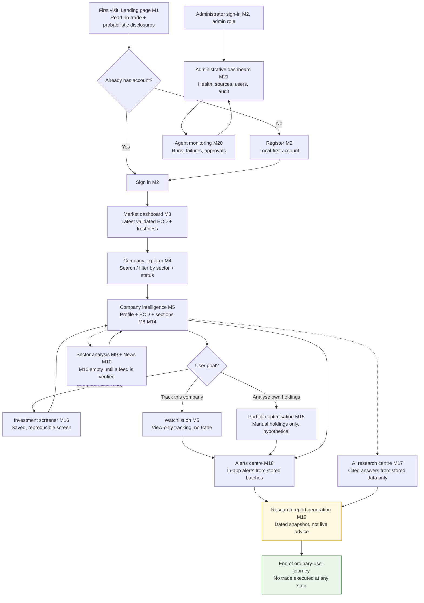

# PSX Intelligence AI — User Workflow (Phase 1 of 30)

> **Team 9 — Website Module Specification + User Workflow. Phase 1 only.**
> Companion to `WEBSITE_MODULE_SPECIFICATION.md` by the same team.
> This file specifies workflows; it delivers no application code, no
> running website, and no later-phase implementation. Module numbers
> below (M1–M21) refer to the modules in the companion specification.
> This file was written by Team 9 alone; sibling teams' files were not
> modified, and `~/workspace/psx-data-collection/` was used as reference
> only and was not touched.

## File header — stage status (honest record)

The same 11-stage workflow as the companion specification:

| # | Stage | Status |
|---|-------|--------|
| 1 | Brainstorm | DONE — workflows derived from the assigned journey: first visit → registration/login → dashboard → explorer → company intelligence → screener → portfolio → alerts → reports → admin/monitoring. |
| 2 | Research | DONE — sibling-spec and reference-scaffold reading only. No sign-up, install, purchase, credential, or API key was used. |
| 3 | Validate | DONE against the verified starting condition in the companion spec §0; unverified items are marked UNVERIFIED, not assumed. |
| 4 | Data inspection | DONE, READ-ONLY ONLY — no full-scale live data collection was performed in Phase 1, no live polling was performed, and no price or company record is asserted in this file. |
| 5 | Architecture planning | DONE — workflows follow the companion module spec and the fixed stack; steps that need a later-phase capability name it as a dependency. |
| 6 | Implementation specification | DONE — this file. It specifies what later phases must build; it does not build it. |
| 7 | Documentation | DONE — this file, plus the companion specification. |
| 8 | Testing strategy | DONE — how each workflow WILL be tested in later phases. No test is claimed to have passed. |
| 9 | Independent audit | NOT DONE — reserved for the coordinator / independent audit in Phase 1 close-out (and Phase 23). |
| 10 | Correction | PENDING — after audit findings only. |
| 11 | Checkpoint | PENDING — Phase 1 is complete only when the coordinator audit passes. This file alone does not close Phase 1. |

## 0. Rules that govern every workflow in this file

1. **No real trades, ever, in Phase 1 scope and in the initial system.**
   The system must NOT execute real trades initially, must NOT connect
   to a broker, and must NOT place, amend, or cancel any order.
   BUY / HOLD / SELL / WATCHLIST are probabilistic recommendations
   with uncertainty shown, for information only. This restriction is
   restated at **every** workflow step below where a trade-like action
   might otherwise be expected, not merely once in this introduction.
   There is no "Buy", "Sell", "Place order", or "Execute" step in any
   workflow.
2. **Forecasts are probabilistic, never guaranteed.** Any workflow step
   that shows a forecast or recommendation must also show its
   uncertainty band, model / rule identity, and limitations.
3. **Deterministic numbers only from deterministic code; LLMs never
   invent numbers.** A workflow step that shows a number must be able
   to trace it to a stored, validated record; a narrative step may
   only restate stored numbers.
4. **Budget PKR 0.** No workflow step requires a paid API, subscription,
   hosting, database, storage, monitoring, or AI/LLM subscription.
   Local hardware, electricity, and internet are external operating
   expenses — disclosed, never called free. No permanent free hosting
   is assumed.
5. **No live polling.** "Latest" in any workflow means the latest
   stored, scheduled-refresh batch, labelled with its capture time.
6. **No invented API, endpoint, price, or capability.** Workflow steps
   name the data a step needs, not an invented route. Exact internal
   routes are fixed in Phase 22.
7. **UNVERIFIED sources are never silently used.** Where a workflow
   would need SECP, SBP, PBS, Finance Division, World Bank, IMF,
   FRED, an official PSX API, a historical intraday archive, a
   structured financial-statement feed, or a news/announcements feed,
   the step is marked UNVERIFIED and the workflow degrades to an
   explicit unavailable state (see §3). The full UNVERIFIED register
   is in the companion spec §6 and is summarised in §7 below.
8. **Error / empty-data handling is part of every workflow, not an
   afterthought.** Each workflow below has an explicit section for
   stale, missing, and UNVERIFIED-source cases.

## 1. Workflow diagram (Mermaid)

Reading note: every arrow that passes through a recommendation,
forecast, watchlist, alert, portfolio, or report step carries the
no-trade restriction — those steps are view / analysis / notification
only. The diagram contains no broker, order, or execution node, because
none exists in this system.

## 2. Actors

| Actor | Description |
|---|---|
| Visitor | Unauthenticated person on the landing page. Can read public disclosures only; cannot see personal data or admin functions. |
| Registered user | Signed-in ordinary user. Owns watchlists, manual portfolios, saved screens, alerts, and reports. Cannot reach admin functions. |
| Administrator | Signed-in user with the administrator role. Manages users, roles, configuration, health, and audit views. Cannot trade, connect a broker, or send on a user's behalf via any workflow here. |
| System (collector / agents) | Not a human actor. Scheduled collector batches and agent runs supply validated data and logs; they never act as a user, never trade, and never send externally in Phase 1 scope. |

## 3. Shared error / empty-data handling (applies to every workflow)

| Situation | Required handling in every workflow |
|---|---|
| No validated data for the selection | Show "No validated data available for this selection yet" + the next useful action (change date range / selection, or check back after the next scheduled refresh). Never show zeros, blanks presented as values, or invented figures. |
| Stale data (latest EOD / snapshot older than expected) | Amber banner with the last-good date and "figures may be out of date". The user may still view the stale figures, clearly labelled as stale. |
| Missing date in a series (e.g. collector 404 quirk, non-trading gap) | Gap shown as a gap in charts/tables, with a collector note where available. Never silently interpolated, never bridged as if continuous. |
| UNVERIFIED source needed (SECP, SBP, PBS, Finance Division, World Bank, IMF, FRED, official PSX API, intraday archive, statement feed, news feed) | Field / section hidden or greyed with "depends on a source not yet verified for machine use and is not shown as fact". The workflow continues around it; it never fills the gap with a guess, a substitute source, or an LLM invention. |
| Internal read failure | Plain-language error + retry action. Partial results are never presented as complete. |
| Forecast / recommendation unavailable | "Insufficient validated data" or "factor missing" state, with the missing input named. Never a default label. |
| Trade-like expectation (user looks for a buy/sell/execute control) | No such control exists. The screen states: "Probabilistic recommendation for information only. This system does not execute trades and is not connected to a broker." The only related actions are view, watchlist, alert, and report — all non-executing. |

## 4. Workflows

Each workflow follows the same structure: Actor; Preconditions; Steps;
Decision points; Error / empty-data handling; Outputs; Acceptance
criteria. The no-trade restriction is restated inside any workflow
where a trade-like action might be expected.

---

### W1 — First visit (Visitor → Landing page, M1)

- **Actor:** Visitor (unauthenticated).
- **Preconditions:** None. No account, sign-up, or payment is required
  to read the landing page.
- **Steps:**
  1. Visitor opens the website and lands on M1.
  2. Visitor reads: what the system is, its coverage (as verified:
     ~496 trading vs ~1029 listed, 38 sectors, ~5y EOD — with the
     caveat that this is as supplied by the verified libraries, not
     an official PSX guarantee), its no-trade position, and that
     forecasts are probabilistic.
  3. Visitor reads data-source and licence attributions (psx-dps MIT,
     psxdata MIT; Eulerpool explicitly not a PSX source).
  4. Visitor chooses: register (→ W2) or sign in (→ W3), or leaves.
- **Decision points:** Register vs sign in vs leave. No other decision
  is offered to a visitor; no market data requiring sign-in is shown
  as if it were public trading advice.
- **Error / empty-data handling:** If an optional market snapshot is
  shown and no validated snapshot exists, the snapshot area shows
  "no validated snapshot available" rather than a stale or invented
  figure. A failed page load shows a plain error, not a partial page
  presented as complete.
- **Outputs:** An informed visitor who can state that the system does
  not trade and forecasts are probabilistic — or a visitor who leaves
  without registering. No account, data, or transaction is created.
- **Acceptance criteria:** (a) No-trade, probabilistic, and coverage
  disclosures are visible without signing in. (b) No broker, order,
  or "buy now" control exists. (c) Any snapshot carries a timestamp
  or is absent with an unavailable note.

### W2 — Registration (Visitor → Registered user, M2)

- **Actor:** Visitor → Registered user.
- **Preconditions:** Visitor has read W1 disclosures. No payment,
  broker account, or external identity provider is required or
  requested (PKR 0).
- **Steps:**
  1. Visitor selects Register on M1 and is taken to the M2
     registration form (fields as fixed in Phase 21 — not invented
     here).
  2. Visitor completes the form and submits it.
  3. System validates input, creates a local-first account with the
     ordinary-user role, stores a credential hash (never plaintext),
     and records the creation in the audit log.
  4. System signs the user in (or directs them to sign in, per the
     Phase 21 flow) and lands them on M3 (→ W4).
- **Decision points:** Valid submission → account created; invalid
  submission → field errors shown, no account created, no partial
  account left behind.
- **Error / empty-data handling:** Validation errors name the field
  and the rule in plain language. A system failure during creation
  leaves no half-created account visible to the user; the user is
  told to retry. **No-trade note:** registration creates no trading
  capability whatsoever — a registered user can view analysis only.
- **Outputs:** A local-first ordinary-user account; an audit entry;
  a signed-in session.
- **Acceptance criteria:** (a) No password is stored or displayed in
  plaintext. (b) A new account has the ordinary-user role only.
  (c) Creation is audited. (d) Registration never requests broker,
  payment, or paid-service details.

### W3 — Sign-in / sign-out (Registered user or Administrator, M2)

- **Actor:** Registered user; Administrator (same flow, role differs
  after sign-in).
- **Preconditions:** An account exists (W2). No external login
  provider is assumed.
- **Steps:**
  1. User selects Sign in and submits credentials on M2.
  2. System verifies the credential hash and creates a session with
     an expiry (Phase 21 / 27).
  3. Ordinary user → M3 (W4). Administrator → choice of M3 or M21
     (W11); admin routes remain role-gated after sign-in.
  4. Sign-out ends the session; the next visit returns to W1.
- **Decision points:** Correct credentials → signed in; incorrect →
  generic failure (see below); expired session → user is returned to
  sign-in with a plain "session expired" message, and any unsaved
  personal input (e.g. an unsaved screen draft) is handled per the
  Phase 21 rule — it is never silently submitted.
- **Error / empty-data handling:** Sign-in failure must not reveal
  whether an account exists. Repeated failures are handled per the
  Phase 21 / 27 rate-limit rule (fixed there, not invented here).
  Password-reset delivery via email/SMS is UNVERIFIED as a zero-cost
  channel — if Phase 21 cannot provide it at PKR 0, the reset path
  must be the in-app / administrator-assisted path Phase 21 specifies,
  and the user must be told which path applies rather than being
  left with a broken "email sent" message.
- **Outputs:** An authenticated session (or a clean failure); audit
  entries for sign-in and role-sensitive access.
- **Acceptance criteria:** (a) Failure messages do not leak account
  existence. (b) An ordinary user cannot reach M21 by any route,
  including direct URL. (c) Expired sessions do not retain access.
  (d) Sign-in never creates trading or broker access.

### W4 — Market dashboard (Registered user, M3)

- **Actor:** Registered user.
- **Preconditions:** Signed in (W3). Validated EOD data may or may
  not exist for the latest date — the workflow must work in both cases.
- **Steps:**
  1. User lands on M3 after sign-in.
  2. User views: latest EOD date, market breadth, sector overview
     (38 sectors), movers by the stated rule, and the data-health
     strip (last collector run, missing symbols).
  3. User clicks a sector → W8 (sector analysis, M9) — or a company
     → W6 (company intelligence, M5).
  4. User optionally changes the reference EOD date within the
     validated range and the dashboard recomputes from stored rows.
- **Decision points:** Latest EOD current → normal view; latest EOD
  stale → banner acknowledged, stale figures viewed with their date;
  no EOD for the chosen date → empty state (see below).
- **Error / empty-data handling:** Stale → amber banner with the
  last-good date. Missing date → "No validated data for this date"
  + suggestion to pick the latest available date. UNVERIFIED macro /
  live-index overlays are not shown at all (see §3). **No-trade
  note:** the dashboard shows market information only. If a
  recommendation or mover list tempts a trade-like action, there is
  no control to act on it — the user can only view, explore, or
  watchlist (W6/W9).
- **Outputs:** An oriented user with a dated market picture and a
  next step (sector or company). No transaction, no order, no alert
  is created by viewing the dashboard.
- **Acceptance criteria:** (a) Every figure shows its EOD date.
  (b) Breadth reconciles to validated rows. (c) Stale data produces
  a visible banner. (d) No figure is labelled "live" without a
  snapshot timestamp.

### W5 — Company explorer (Registered user, M4)

- **Actor:** Registered user.
- **Preconditions:** Signed in (W3). Company directory loaded from
  validated data (Phases 2, 5).
- **Steps:**
  1. User opens M4 from the dashboard or navigation.
  2. User searches by symbol / name and/or filters by sector and by
     trading vs listed-only status.
  3. User sorts and pages through results; each row shows symbol,
     name, sector, trading status, and latest validated EOD date
     (or "no validated EOD yet").
  4. User clicks a company → W6 (M5).
- **Decision points:** Results found → proceed to a company;
  no results → broaden filters (suggested on screen); listed-only
  symbol → user is told it is listed-only, so no EOD-based analysis
  should be expected for it.
- **Error / empty-data handling:** Empty result set → explicit empty
  state with a "clear filters" action, never a fabricated suggestion.
  Symbol with no EOD → row shows that fact, not a blank price.
  **No-trade note:** finding a company is discovery only. The
  explorer contains no buy/sell/execute control, and a listed-only
  symbol is never presented as tradeable.
- **Outputs:** A selected company (→ W6) or a deliberate decision to
  broaden the search. No holding, order, or alert is created here.
- **Acceptance criteria:** (a) Every validated directory company is
  findable; no company outside it appears. (b) Trading vs
  listed-only status is visible per row. (c) Empty results are
  explicit. (d) No result implies tradeability beyond its status.

### W6 — Company intelligence (Registered user, M5 + M6–M14 sections)

- **Actor:** Registered user.
- **Preconditions:** Signed in (W3); company selected via W4 or W5.
  Some sections may be empty because their sources are UNVERIFIED
  (Modules 6 and 10 in particular) — the workflow must still be
  completable.
- **Steps:**
  1. User opens the company page (M5): header, sector, trading status.
  2. User views the EOD price chart for a chosen validated date range
     (M5/M8); gaps in the series are shown as gaps.
  3. User expands, in any order: financial statements (M6),
     fundamentals (M7), technicals (M8), valuation (M11), forecast
     (M12), recommendation (M13), risk (M14) — each section showing
     its source, date, and uncertainty where applicable.
  4. User optionally adds the company to a watchlist (user data only),
     opens the AI research centre for a cited question (W10, M17),
     or proceeds to screener / portfolio / alerts / reports
     (W7–W9).
- **Decision points:** Section has validated data → view it;
  section source UNVERIFIED or empty → placeholder with the reason
  ("source not verified" / "no validated data for this period") and
  the workflow continues with the sections that do have data.
  Recommendation shown → user may watchlist or set an alert; the
  user may NOT execute anything from it (see no-trade note).
- **Error / empty-data handling:** Per §3, plus: a ratio, valuation,
  forecast, or risk measure whose inputs are missing shows
  "unavailable" with the missing input named — never a default value.
  A forecast shows its band, model, version, and training window, or
  it is not shown. **No-trade restriction (restated at this step,
  where a trade-like action is most likely to be expected):**
  BUY / HOLD / SELL / WATCHLIST labels here are probabilistic
  recommendations for information only. This system does not execute
  trades, is not connected to a broker, and provides no control to
  buy, sell, place an order, or apply a recommendation to a real
  account. The only actions are: view, add to watchlist (tracking
  only), set an alert (notification only), or include in a report
  (snapshot only).
- **Outputs:** An understood company picture (with gaps honestly
  shown); optionally a watchlist entry; a chosen next workflow.
  No trade, order, or holding in a real account is created.
- **Acceptance criteria:** (a) No section shows a number without
  source and date. (b) UNVERIFIED sections are placeholders.
  (c) Watchlist changes affect only the acting user. (d) The
  no-trade banner is present with any recommendation.

### W7 — Investment screener (Registered user, M16)

- **Actor:** Registered user.
- **Preconditions:** Signed in (W3). At least one criterion's source
  module has stored data; criteria without validated inputs are not
  offered (see decision points).
- **Steps:**
  1. User opens M16 and builds a screen: adds criteria (fundamental,
     technical, valuation, sector, market, risk — only offered
     criteria), composes them per the Phase 10 engine rules, and
     runs the screen on a stated data vintage.
  2. User views results: passing companies with the criterion values
     that passed them, plus the excluded-for-missing-data list.
  3. User saves the screen (per-user), renames / edits / deletes it,
     re-runs it on a newer vintage, or clicks a result → W6.
  4. User optionally exports results as a snapshot with provenance.
- **Decision points:** Criterion offered vs not offered (not offered
  if its input is UNVERIFIED or empty — the user is told why, not
  given a substitute criterion). Company passes vs fails vs excluded
  for missing data (three distinct outcomes, never conflated).
  Save vs run-once (run-once results are not persisted as a screen).
- **Error / empty-data handling:** No company passes → explicit
  "no companies passed this screen on this vintage" + the criterion
  values, not an empty table presented as an error. A criterion
  input missing for a company → that company appears in the
  excluded-for-missing list with the missing input named.
  **No-trade restriction (restated here, because a screen result
  looks like a buy list):** a screener result is a filtered view for
  information only. It is not a buy list, not an instruction, and it
  has no control to buy, sell, or execute anything from the results.
  The only actions are: view a company (W6), watchlist it (tracking
  only), or include results in a report (W9, snapshot only).
- **Outputs:** A saved screen definition and/or a dated, reproducible
  result set (screen + vintage → same results). No order or holding
  is created.
- **Acceptance criteria:** (a) Result rows show passing criterion
  values. (b) Missing-data exclusions are listed with reasons.
  (c) Same screen + same vintage re-runs identically. (d) No
  execution control exists on results.

### W8 — Sector analysis, with news (Registered user, M9 + M10)

- **Actor:** Registered user.
- **Preconditions:** Signed in (W3). Sector mapping (38 sectors)
  from validated data.
- **Steps:**
  1. User opens M9, chooses a sector, and views its aggregate,
     breadth, constituent list, and history over validated EOD dates.
  2. User compares sectors in the comparison table.
  3. User optionally opens M10 news / announcements filtered by that
     sector or a constituent company.
  4. User clicks a constituent → W6.
- **Decision points:** Sector has enough validated constituents for
  a reliable aggregate → aggregate shown; too few → reliability
  warning shown with the aggregate (per the Phase 8 rule). News
  section: verified items exist → list shown; no verified feed →
  empty state (see below).
- **Error / empty-data handling:** **News / announcements (M10) is
  UNVERIFIED as a machine feed in Phase 1.** Until a feed is verified,
  the news step shows "No verified news / announcements available
  for this selection" — it never shows scraped, guessed, or
  LLM-invented news. Macro explanations for sector movement citing
  SECP / SBP / PBS / Finance Division / World Bank / IMF / FRED are
  UNVERIFIED and are not shown. **No-trade note:** sector strength
  is information only; there is no control to buy a sector, buy its
  constituents as a basket, or execute anything from this view.
- **Outputs:** A dated sector picture and, where verified, a news
  list — or an honest empty news state. No transaction is created.
- **Acceptance criteria:** (a) Sector aggregates reconcile to
  constituents. (b) Thin sectors carry a reliability warning.
  (c) With no verified news feed, M10 honestly shows no items.
  (d) No macro claim appears without a verified source.

### W9 — Portfolio, alerts, and watchlist loop (Registered user, M15 + M18 + M5 watchlist)

This workflow combines three linked personal-data loops, because in
use they feed each other: a watchlist entry (W6) can become an alert,
and a manual portfolio can be optimised and then alerted on. They are
kept as one workflow here so the no-trade boundary is stated once for
the whole loop and then repeated at each trade-like step.

- **Actor:** Registered user.
- **Preconditions:** Signed in (W3). For portfolio steps, the user
  has manually entered holdings; no brokerage import exists or is
  assumed. For alert steps, the user has a company / watchlist entry
  to alert on.
- **Steps:**
  1. **Watchlist:** User adds / removes companies on M5. The
     watchlist is tracking only — a list of companies to monitor.
  2. **Manual portfolio:** User enters holdings manually on M15
     (symbol, quantity, entry price / date — all labelled
     user-entered, with entry date). User edits / deletes holdings.
  3. **Optimisation:** User runs an optimisation over a chosen
     validated EOD window with stated constraints. User views the
     current-manual vs optimised-allocation comparison, both dated.
     User may save the analysis as a report input (→ W11 report
     step, M19).
  4. **Alerts:** User creates an alert on M18 (company, condition
     from the Phase 15 catalogue, threshold). When a new validated
     batch lands and the condition is met on that vintage, the alert
     fires once, in-app, and appears in firing history with its
     triggering value and vintage. User acknowledges / dismisses it,
     or disables / deletes the alert.
  5. User returns to W6 to re-examine a company behind an alert or
     an optimised weight.
- **Decision points:** Manual holding vs brokerage holding — only
  manual holdings exist in this system; any expectation of an
  imported real portfolio is corrected on screen ("holdings here are
  manually entered for analysis only"). Optimised allocation vs
  current manual allocation — both are hypothetical views; neither
  is applied. Alert fires vs does not fire — firing requires a new
  validated batch meeting the condition; unchanged data never
  re-fires. Alert enabled vs disabled — disabled alerts never fire.
- **Error / empty-data handling:** Symbol with too little validated
  EOD → excluded from optimisation with a note, not optimised on
  invented data. Alert condition whose input is UNVERIFIED or
  intraday-based → condition not offered. Alert delivery is in-app
  only; SMS / email / push providers are UNVERIFIED at PKR 0 and are
  not promised. A firing with a missing vintage → not shown as
  fired; the failure is logged for admin review (W12).
- **No-trade restriction (restated at each trade-like step in this
  loop):**
  - *Watchlist:* adding to a watchlist does not buy anything and
    does not reserve, order, or hold any security.
  - *Manual portfolio:* entering a holding does not record a real
    purchase; it records what the user typed, for analysis only.
  - *Optimisation:* an optimised allocation is hypothetical. There
    is no "apply this allocation", "rebalance", or broker control,
    and the allocation is never applied to a real account.
  - *Alerts:* an alert is a notification to look at information. It
    never places an order, never links to an order, and never
    executes anything when it fires.
- **Outputs:** A per-user watchlist; a per-user manual portfolio;
  a dated, reproducible optimisation result; per-user alert
  definitions and a complete firing history. No real holding, order,
  or transaction is created by any step.
- **Acceptance criteria:** (a) All personal data is isolated per
  user. (b) Optimisation weights, constraints, and window are
  displayed; weights respect stated constraints. (c) An alert fires
  at most once per new triggering batch and shows its vintage.
  (d) No apply / rebalance / buy / sell / execute control exists in
  the loop.

### W10 — AI research centre (Registered user, M17)

- **Actor:** Registered user.
- **Preconditions:** Signed in (W3). The question must be answerable
  from validated stored data — or the centre must say it is not.
- **Steps:**
  1. User opens M17 and types a research question (or picks a
     suggested question limited to topics the validated store can
     answer).
  2. System (local Ollama open-weight only, Phase 12) composes an
     answer citing stored records; every numeric claim carries a
     checkable citation.
  3. User reads the answer with its disclaimer (probabilistic, not
     advice, no trade execution), follows a citation to its source
     screen (W6 or the relevant module), and optionally saves the
     answer as a report input (→ W11).
  4. User optionally flags the answer as unhelpful (feedback stored
     per user for later quality review; no automatic retraining).
- **Decision points:** Answerable from validated data → cited answer;
  needs an UNVERIFIED source (macro, news feed, intraday, statement
  feed before verification) → explicit "not available from validated
  data" answer, not a guessed answer. Question asks the system to
  ignore its citation rule, reveal system instructions, or invent
  data → refused as an instruction; answered only from validated
  data or not at all (Phase 27 hardening).
- **Error / empty-data handling:** No citation available → no numeric
  answer is given. A cited record that has since been corrected /
  quarantined is handled per the Phase 4 rule and the answer history
  must not silently rewrite itself. **No-trade note:** an AI answer
  is research information only. Even if an answer discusses a
  recommendation, it provides no control to act on it, and its
  disclaimer states that the system does not execute trades.
- **Outputs:** A cited answer (or an honest "not available" answer)
  in per-user Q&A history; optionally a report input. No trade,
  order, or external send is created.
- **Acceptance criteria:** (a) Every numeric claim has a checkable
  citation or the answer says data is unavailable. (b) No paid LLM
  API is used. (c) History is per-user only. (d) The disclaimer is
  visible with every answer.

### W11 — Research report generation (Registered user, M19)

- **Actor:** Registered user.
- **Preconditions:** Signed in (W3). The user has selected a subject
  already analysed in W6–W10 (company, sector, screen, manual
  portfolio, or cited Q&A). No report can be generated about a
  subject with no validated analysis.
- **Steps:**
  1. User opens M19 and selects the subject and the sections to
     include.
  2. System assembles the report: cover block (title, subject,
     generation date (PKT), data vintage, "snapshot — not live"
     label, no-trade disclaimer), then each chosen section with its
     source, as-of date, and uncertainty note.
  3. User previews, saves, and downloads / prints the snapshot.
  4. User optionally regenerates on newer data — this creates a
     **new** dated version; the old version is unchanged.
  5. User re-opens a saved report from their saved-report list.
- **Decision points:** Section source validated → included; section
  source UNVERIFIED → omitted with a note ("section omitted: source
  not verified"), never filled. Regenerate → new version, never an
  overwrite of history.
- **Error / empty-data handling:** Subject with no validated data →
  report cannot be generated; the user is told which inputs are
  missing. A section that becomes unavailable after generation does
  not retroactively change a saved snapshot. **No-trade restriction
  (restated here, because a report looks like formal advice):** a
  report is a dated snapshot of probabilistic analysis for
  information only. It is not investment advice, not a recommendation
  to transact, and it contains no control — and no instruction that
  the user can forward to a broker — to buy, sell, or execute
  anything. Downloading or sharing a report executes nothing.
- **Outputs:** A dated, saved report snapshot (per-user), with
  provenance and disclaimers carried into the download. No trade,
  order, or external send is created.
- **Acceptance criteria:** (a) Cover block (date, vintage, snapshot
  label, disclaimer) renders on every report and download.
  (b) Every section carries source + as-of date. (c) Regeneration
  creates a new version; old versions are immutable. (d) UNVERIFIED
  sections are omitted with a note, not filled.

### W12 — Admin and monitoring (Administrator, M21 + M20)

- **Actor:** Administrator.
- **Preconditions:** Signed in with the administrator role (W3).
  Ordinary users must never reach this workflow.
- **Steps:**
  1. Administrator opens M21 and views system health: collector run
     status, last successful refresh, missing symbols, validation /
     quarantine counts, storage state.
  2. Administrator views the source-status panel: verified sources
     with status; UNVERIFIED sources listed as "not verified — not
     in use".
  3. Administrator manages users and roles (list, disable / enable,
     role change — each change audited with actor and timestamp),
     views audit logs (sign-ins, role changes, admin actions, agent
     approvals), and adjusts configuration within Phase 20 bounds
     (e.g. hiding a module's data area until its source is verified).
  4. Administrator opens M20 (agent monitoring) and reviews agent
     runs: completed / failed / awaiting approval, with inputs,
     outputs, citations, and errors; failures and quarantine items
     are visible, not hidden.
  5. Administrator acts on an approval item only where Phase 16
     provides a gate and the administrator's role permits it. No
     approval releases a trade or an external send, because no such
     action exists in Phase 1 scope.
  6. Administrator reviews quarantine items (Phase 4) and triggers
     re-validation where Phase 20 allows it; every trigger is logged.
- **Decision points:** Health green vs degraded — a failed collector
  run or a validation failure is shown as a failure, never as green.
  User action (disable / role change) vs view-only — every change
  requires an explicit admin action and creates an audit row.
  Approval item: approve / reject / leave pending — only within the
  Phase 16 gate rules.
- **Error / empty-data handling:** No collector run yet → health
  shows "no run recorded", not a healthy status. Audit log empty →
  explicit empty state, not a missing panel. A monitoring log row
  can never be edited to hide a failure (append-only in spec).
  **No-trade restriction (restated here, because admin power is
  broadest here):** the admin dashboard has no broker, order,
  payment, or external-send control. An administrator cannot use it
  to trade, to send on a user's behalf, to connect a paid service
  without separate approval, or to bypass the provenance, no-trade,
  or per-user privacy rules for any user.
- **Outputs:** Audited admin actions; a visible health / source /
  agent picture; logged re-validation triggers. No trade, payment,
  or external send is created.
- **Acceptance criteria:** (a) No non-admin reaches any admin
  function, including by direct URL. (b) Every admin action is
  audited with actor and timestamp. (c) Failures are visible, never
  hidden or shown as healthy. (d) UNVERIFIED sources are shown as
  not in use. (e) No trading, broker, payment, or external-send
  control exists in the admin surface.

## 5. End-to-end journey summary (ordinary user)

| Step | Workflow | Module(s) | Trade-like expectation — and the answer |
|---|---|---|---|
| First visit | W1 | M1 | None — disclosures only. |
| Register | W2 | M2 | Registration creates no trading capability. |
| Sign in | W3 | M2 | Sign-in creates no trading or broker access. |
| Dashboard | W4 | M3 | Market view only; no action control. |
| Explorer | W5 | M4 | Discovery only; listed-only ≠ tradeable. |
| Company intelligence | W6 | M5–M14 | Recommendations are view-only, probabilistic, with uncertainty; no buy/sell/order control. |
| Screener | W7 | M16 | Results are a filtered view, not a buy list; no execution control. |
| Sector + news | W8 | M9, M10 | Sector view only; news honestly empty until a feed is verified; no basket order. |
| Portfolio / alerts / watchlist | W9 | M15, M18, M5 | Watchlist = tracking; manual portfolio = typed analysis; optimisation = hypothetical; alert = notification. None executes. |
| AI research | W10 | M17 | Cited information only; no action control. |
| Report | W11 | M19 | Dated snapshot, not advice; downloading executes nothing. |
| Admin / monitoring | W12 | M21, M20 | Admin-only; no broker, payment, or external-send control. |

## 6. How these workflows WILL be tested (later phases — nothing claimed as passed)

- **Playwright end-to-end journeys (Phase 23):** one scripted journey
  per workflow W1–W12 on fixture data: register → sign in → dashboard
  → explorer → company → screener → portfolio → alerts → report, plus
  the admin journey W12 with a separate admin fixture user. Each
  journey asserts its acceptance criteria, including the presence of
  the no-trade banner wherever a recommendation appears and the
  absence of any order control (asserted by searching the rendered
  page for order-like controls and failing if one is found).
- **Fixture-data tests (Pytest, Phases 4–15):** every workflow step
  that displays a number is tested against a small hand-computed
  fixture (breadth, ratios, indicators, aggregates, screen results,
  optimisation weights, alert firings) — the displayed value must
  match recomputation.
- **Empty / stale / UNVERIFIED tests:** for each workflow, a fixture
  with (a) no data, (b) stale data, and (c) an UNVERIFIED source is
  run, and the required banner / placeholder / omission note is
  asserted. A workflow that renders a guess in any of these cases
  fails.
- **Isolation tests:** watchlists, portfolios, screens, alerts,
  reports, and Q&A history created by one fixture user must never
  appear for another fixture user; admin routes must deny the
  ordinary fixture user, including by direct URL.
- **No-test-passed disclaimer:** no test described here has been run
  in Phase 1, because no application code exists to test. These are
  test plans for later phases, not results.

## 7. UNVERIFIED register (summary — full register in companion spec §6)

1. SECP, SBP, PBS, Finance Division, World Bank, IMF, FRED — machine use: UNVERIFIED.
2. Official PSX API — none verified: UNVERIFIED.
3. Historical intraday archive — none verified: UNVERIFIED.
4. Guaranteed real-time / continuous feed — none verified: UNVERIFIED.
5. Structured financial-statement machine source (blocks M6 data): UNVERIFIED.
6. News / announcements machine feed (blocks M10 data): UNVERIFIED.
7. Email / SMS / push delivery at PKR 0 (blocks external alert delivery; in-app only): UNVERIFIED.
8. Permanent free hosting / hosted database / hosted monitoring at PKR 0: UNVERIFIED, not assumed.
9. Any price, index level, rate, company figure, or benchmark as fact: NOT STATED in this file.
10. Agent functions beyond Agents 1–6 (forecasting, decision support, valuation, risk, screening, optimisation, alerts, report narrative, orchestration, news ingest): required but NOT YET REGISTERED — Phase 16 dependency.
11. Exact internal API routes: NOT YET FIXED (Phase 22), not invented here.

## 8. What this workflow specification deliberately does NOT do

- It does not start Phase 2 or any later phase, and it does not deliver
  application code, a database, a deployment, or a test run.
- It does not claim any workflow works, any test has passed, or any
  data has been collected at scale.
- It does not invent an API, endpoint, price, capability, or source.
- It does not authorise any spend, sign-up, install, credential,
  broker connection, live polling, trading, or posting.
- It does not describe local hardware, electricity, or internet as
  free — they are external operating expenses.
- It does not promise a delivery time. Later-phase timing is for the
  coordinator's plan, not this specification.

## 9. Open items for the coordinator audit (Phase 1 close-out)

1. Independent audit (stage 9) has not been performed.
2. Agent functions beyond Agents 1–6 need registration in Phase 16
   before W9–W12 can be implemented as specified.
3. W6 and W8 are honestly partial until statement and news sources
   are verified; the audit should confirm that partiality is accepted
   as the Phase 1 position.
4. Password-reset delivery at PKR 0 needs a Phase 21 decision (in-app
   / administrator-assisted vs a verified zero-cost channel).
5. No delivery time is promised in this file.

---

*End of Team 9 User Workflow — Phase 1 of 30. STOP AFTER PHASE 1.*
